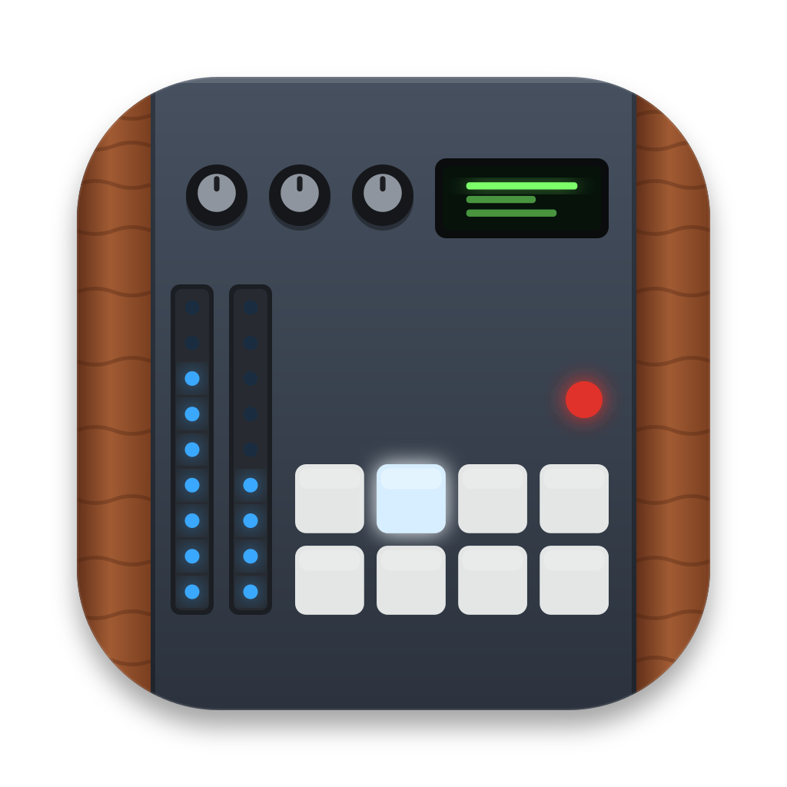
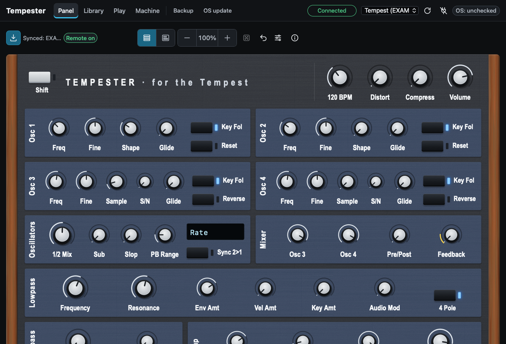
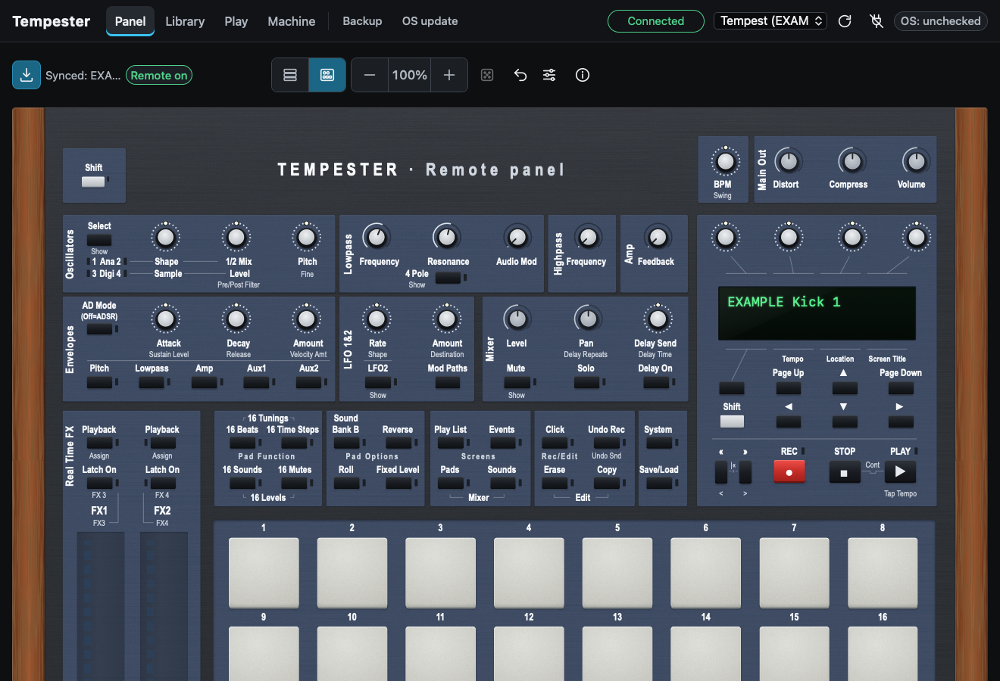
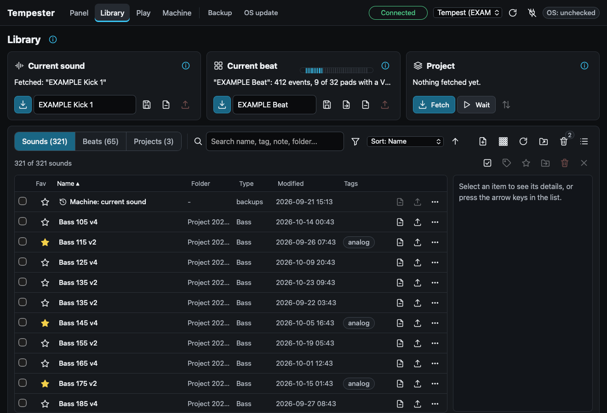
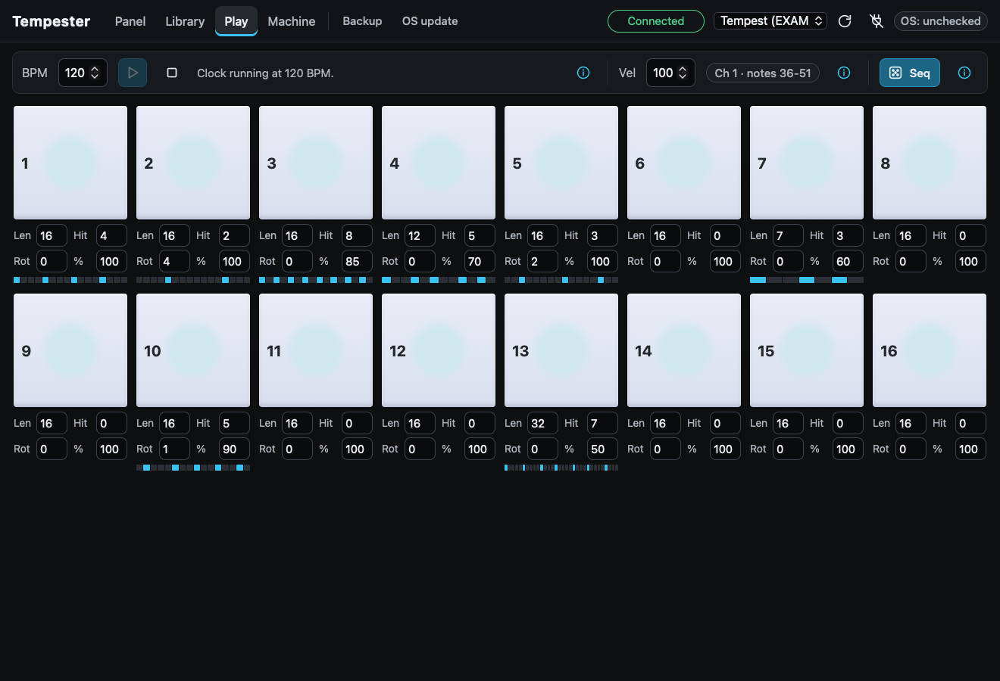
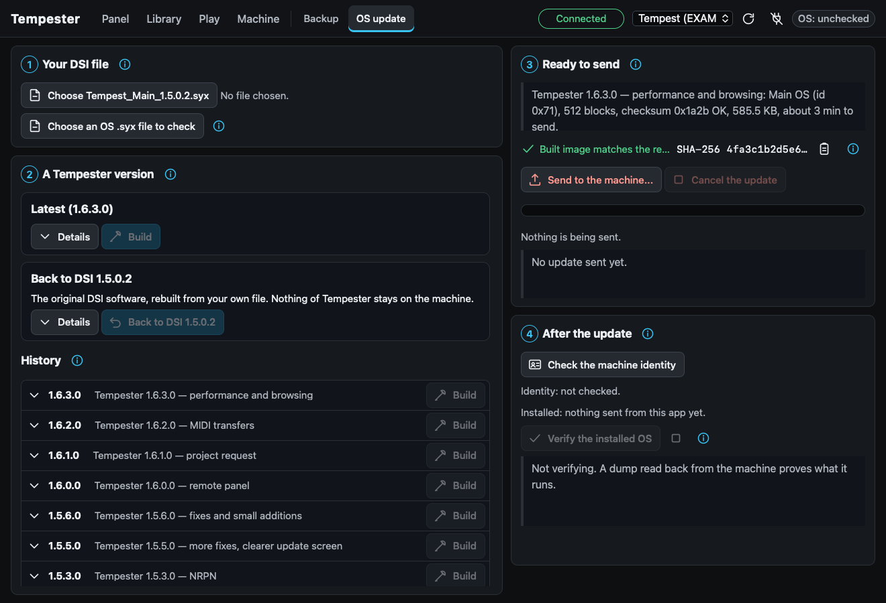
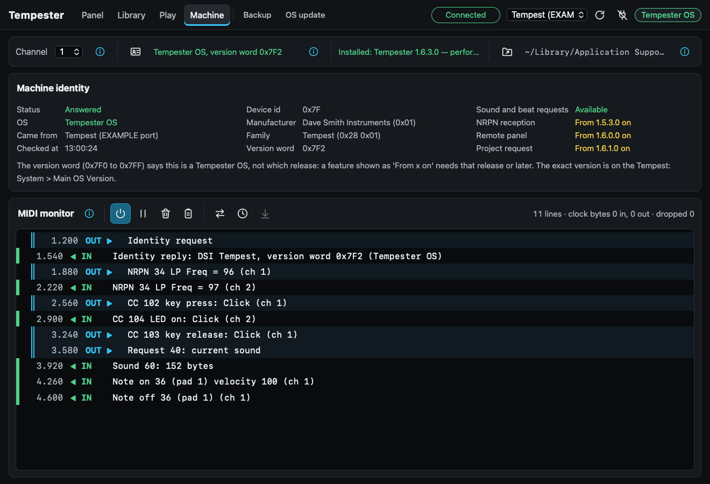
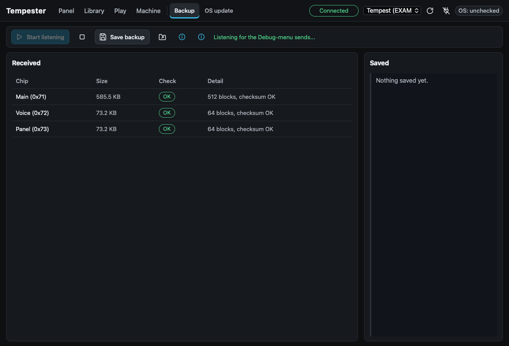

  

<h1 align="center">Tempester</h1>

  <strong>Community firmware, a desktop editor and a DAW plugin for the DSI Tempest drum machine.</strong> 
  Free and open source. Built from your own copy of the official OS, checked at every step.

  
  
  
  
  

  <a href="#get-started">Get started</a> ·
  <a href="https://github.com/onedevinap/tempester/releases">Download</a> ·
  <a href="#tempester-os-releases">Firmware releases</a> ·
  <a href="#documentation">Documentation</a> ·
  <a href="#faq">FAQ</a>

  

## What is Tempester?

Tempester fixes long-standing bugs of the Tempest, opens the machine up over MIDI, and lets a computer edit, store and
back up what it holds. It has three parts that work together.

- **Tempester OS** is a set of community firmware releases for the Tempest's Main board. They fix freezes, lost notes,
  silent voices and memory corruption, and add what the official OS never had: sound, beat and project requests,
  NRPN in both directions, the whole front panel over MIDI, FX ribbons over MIDI, a footswitch that plays a pad, a play
  probability for each pad, and more. Each release is a *recipe* that you apply to your own official OS file.
- **The Tempester app** for macOS, Windows and Linux: a remote panel, a library for sounds, beats and projects, a
  step sequencer, a MIDI monitor, and a safe installer for Tempester OS that checks every file and reads the result
  back from the machine.
- **Tempester Control** is a CLAP and VST3 plugin that turns the Tempest's sound parameters into automatable
  parameters in your DAW.

> [!NOTE]
> Tempester is an independent project. It is **not affiliated with, endorsed by or supported by** Sequential, Dave Smith
> Instruments, Focusrite or Roger Linn Design. See [Legal](#legal).

## Highlights

<table>
  <tr>
    <td width="50%" valign="top">
      
      
<strong>Remote panel.</strong> The Machine view draws the real panel's controls in their places and plays
      them over MIDI: 49 keys, 14 encoders, 10 knobs, 16 pads and the LEDs. The Full view has all of that plus the 127
      sound parameters, live in both directions.

    </td>
    <td width="50%" valign="top">
      
      
<strong>Library.</strong> Fetch and send sounds, beats and whole projects. Search, tags, favourites, older
      versions and a trash. Nothing is overwritten in silence: what a send replaces is saved first.

    </td>
  </tr>
  <tr>
    <td width="50%" valign="top">
      
      
<strong>Play.</strong> 16 pads, a MIDI clock master and a Euclidean sequencer with a probability for each
      pad. Also in the Library: a kit builder and the export of a beat as a Standard MIDI File.

    </td>
    <td width="50%" valign="top">
      
      
<strong>Safe OS updates.</strong> Builds a Tempester OS release from your own official file, checks it
      against the reference SHA-256, sends it, then reads the installed OS back from the machine and compares.

    </td>
  </tr>
  <tr>
    <td width="50%" valign="top">
      
      
<strong>Machine and MIDI monitor.</strong> The identity of the installed OS and what it can do, and a readable
      log of every message sent and received.

    </td>
    <td width="50%" valign="top">
      
      
<strong>Backup.</strong> Captures the Main, Voice and Panel operating systems that the Tempest sends from its
      Debug menu, with a check of each one.

    </td>
  </tr>
</table>

Screenshots of the app with example data.

## Get started

You need a Tempest, a USB cable (or a MIDI interface on the DIN ports) and a computer.

1. **Install the app.** Download the package for your system from the
   [Releases](https://github.com/onedevinap/tempester/releases) page (macOS, Windows, Debian and Ubuntu). The packages
   are not signed, so the first launch takes one extra click ([how, per system](docs/building.md#installing-a-release-package)).
   You can also [build it from source](docs/building.md#building-and-running-the-app).
2. **Prepare the Tempest.** It must run the complete official **OS 1.5.0.2**: Main 1.5.0.2 with the Voice, Panel
   and SAM files of the same package. Download that package from
   [Sequential's Tempest OS page](https://sequential.com/support/download/tempest-operating-system/) and keep
   `Tempest_Main_1.5.0.2.syx`: every Tempester OS release is built from it. In System, set the SysEx cable, Remote Pad
   IN and Remote Pad OUT ([which values](docs/user-manual.md#setting-up-the-tempest)).
3. **Back up, then install Tempester OS.** Save your project and the OS dumps (Library and Backup pages). On the
   *OS update* page, choose your official file, pick a release and press **Build**: the app checks the result against
   the release's reference SHA-256. Press **Send to the machine** and wait about three minutes, then power the Tempest
   off and on when it says so.
4. **Verify.** System > *Main OS Version* shows the new number. In the app, **Verify the installed OS** reads the Main
   OS back from the machine (Debug menu, *Send Main OS*) and compares it with what was sent.

Read [Before you install](docs/user-manual.md#before-you-install-a-tempester-version) once before the first
installation. To look around first without a machine, start the app with `TEMPESTER_FAKE_MIDI=1`: it then talks to a
simulated Tempest and nothing reaches a MIDI port.

## Tempester OS releases

Tempester OS replaces only the Main OS. Voice, Panel and SAM stay those of the official 1.5.0.2 package. The app offers
every release; these are the ones most people need:

| Release | What it is | Choose it if |
|---|---|---|
| **1.6.4.0** (latest, proved in simulation, **not yet run on a machine**) | 1.6.3.0 plus room for new functions (9.9 KB of dead code erased), the machine reporting its mixer, tempo, Pad Function mode and exact version to an editor, and five bug fixes | you want the newest and accept to be the first to install it; tell us how it goes |
| **1.6.3.0** (latest verified on a real Tempest) | Every fix and every addition: requests, NRPN, remote panel, project transfers, beat-wide positions, FX ribbons over MIDI, footswitch pads, Load Sound memory and alphabetical order, Revert confirmation, per-pad play probability | you want all of Tempester |
| **1.5.6.0** (corrections only) | The bug fixes, plus the sound and beat requests and NRPN; no remote panel, project request or new performance features | you want the fixes and as few changes as possible |
| **DSI 1.5.0.2** (back to official) | The official OS, rebuilt unchanged from your own file | you want to go back |

Full details: [firmware notes](docs/firmware.md) (each change, how it was proved, its limits) and the
[changelog](CHANGELOG.md).

<strong>Everything Tempester OS changes</strong> (with the release that brought it)

**Fixes**

| Change | From |
|---|---|
| No freeze on « Exporting Project »; a received beat no longer overwrites memory | 1.5.1.0 |
| Play Lists: no freeze on an empty step or in RT REC, no write past 100 steps | 1.5.1.0 |
| No Loop Screen freeze outside 4/4 | 1.5.1.0 |
| The pressure of sliders 2 to 4 acts on the real-time FX | 1.5.1.0 |
| Compressor Peak Hold is saved; the compressor envelope follows a beat change | 1.5.1.0 |
| Note length editable up to 255 | 1.5.1.0 |
| A USB SysEx import is no longer cut by traffic on the DIN input | 1.5.1.0 |
| Play List Delete Step no longer writes into the next list | 1.5.5.0 |
| Note FX values stay in their own field; deterministic note-off rule; Voice Assign bounded on load; sequence copy uses the target beat | 1.5.5.0 |
| A received SysEx no longer corrupts Compare and Undo | 1.5.6.0 |
| Voices no longer fall silent with LFO Restart = Play | 1.5.6.0 |
| A USB SysEx no longer causes lost or stuck notes from a DIN keyboard | 1.5.6.0 |
| An abandoned SysEx closes the Receiving screen; a bad beat number in a project is refused | 1.5.6.0 |
| Every SysEx message the machine sends ends in the standard layout | 1.6.2.0 |
| A project sent back to the machine keeps its Play Lists | 1.6.2.0 |
| A SysEx message that never ends is abandoned after about 3 seconds | 1.6.2.0 |
| The Load Sound knob remembers its place in each folder and walks it in alphabetical order | 1.6.3.0 |
| In Pad to Note Mode « Mutes », a note mutes its own pad's sound, bank A or B | 1.6.4.0 |
| The first Save after power-on no longer offers the Factory folder | 1.6.4.0 |
| Undo All Snds and Undo Beat restore sound types, play states, Voice Assign and pad LEDs | 1.6.4.0 |
| Reverse Off clears the reverse of every beat and the live reverse | 1.6.4.0 |
| The Save/Load browser lists a folder in one pass (much faster) | 1.6.4.0 |

**Additions and changes**

| Change | From |
|---|---|
| Requests for the current sound and beat; identity answer on the chosen cable | 1.5.2.0 |
| NRPN for every sound parameter, received and sent | 1.5.3.0 |
| A clearer OS update screen; 1,584 bytes of code space freed | 1.5.5.0 |
| The whole front panel over MIDI: keys, LEDs, encoders and knobs | 1.6.0.0 |
| Request for the whole project; 4 Pole and AD Mode LEDs follow NRPN | 1.6.1.0 |
| The project request draws nothing on the screen | 1.6.2.0 |
| The 8 beat-wide positions of 16 Beats / 16 Mutes reported and set over MIDI | 1.6.2.0 |
| The two FX ribbons over MIDI, both ways | 1.6.3.0 |
| A footswitch can play a pad | 1.6.3.0 |
| A play probability for each pad of each beat (MIDI CC 14) | 1.6.3.0 |
| Revert Snd asks for a second press | 1.6.3.0 |
| 9.9 KB of dead official code erased: room for new functions, same instructions run | 1.6.4.0 |
| Level, Pan, Delay Send, Delay Time, Delay Repeats, BPM, Swing, Volume, Distort and Compress reported over MIDI (NRPN 230-239) | 1.6.4.0 |
| The Pad Function mode reported (CC 106); the exact Tempester version on request (SysEx `43`) | 1.6.4.0 |

Each release contains everything of the earlier ones. Release by release: [firmware notes](docs/firmware.md#versions).
The new MIDI messages: [MIDI protocol](docs/midi-protocol.md).

<strong>Which app features need which OS</strong>

| Feature | Official OS 1.5.0.2 | Tempester OS |
|---|---|---|
| Send sounds, beats, projects and OS files; Backup page; Play page and sequencer; MIDI monitor | yes | yes |
| Receive a project started from the machine's menu | yes | yes |
| Fetch the current sound or beat; kit builder | no | 1.5.2.0 or later |
| Live sound parameters (Panel, Full view); Tempester Control plugin | no | 1.5.3.0 or later |
| Remote panel (Panel, Machine view) | no | 1.6.0.0 or later |
| Fetch the whole project | no | 1.6.1.0 or later |
| Send a project back with its Play Lists | no | 1.6.2.0 or later |

### Why recipes?

The Tempest's firmware belongs to its maker, so this repository contains none of it. A Tempester OS release is a list
of changes written by the project: which words of the Main OS to replace, and with what. You apply it to your own
official file, on your computer, with the app (or a [script](docs/building.md#rebuilding-a-firmware-version-from-your-own-dsi-file)).
Your input file is checked by SHA-256 before anything is done, and the result is checked against the SHA-256 recorded
for the release, so everyone gets exactly the same image. See the [recipe format](docs/patch-recipe-format.md).

## What is tested

We try to say exactly what was checked, and on what.

**Tested**

- **Every Tempester OS release on real hardware.** Each release from 1.5.1.0 to 1.6.3.0 was installed over USB on the
  project's Tempest, one after the other, without any programmer. For 1.5.5.0, 1.6.2.0 and 1.6.3.0, the Main OS read
  back from the machine was identical to the built image over the whole range an update writes.
- **The new features on the machine**: requests, NRPN, the remote panel, the project request and the 1.6.3.0
  additions were used on the machine, over USB.
- **Proofs before any install.** Every change is checked word by word against the official image; the later ones
  also run in an instruction-level simulator of the Main processor on the real firmware code, and the same checks must
  fail on the unpatched image and on deliberately wrong variants. See [testing](docs/testing.md).
- **The app on macOS**, with the machine over USB. Automatic tests run on macOS, Windows and Linux, on a throwaway
  home folder, with counter-proofs for the user-interface tests.

**Not tested yet**

- **Windows and Linux** builds come from CI only. They compile and pass the tests there, but have not been run with a
  Tempest, and their installers have not been installed by a person.
- **Tempester Control** has been built and driven by a test host, but not yet loaded in a real DAW.
- **The DIN cable**: almost everything was done over USB.
- **Going back to DSI 1.5.0.2** on the test machine. It uses the same update path as every install above.
- A few rare paths of the fixes (listed in [testing](docs/testing.md#not-verified)).

Reports from your own machine, especially on Windows, Linux or a DIN cable, help; nothing is promised in return (see
[Support](#support-and-contributions)).

## Safety

Changing the firmware of an instrument always carries some risk. Tempester is designed to keep it small.

- **The update routine is never touched.** The Tempest writes a new Main OS with a routine stored in the last page of
  its flash, and no update rewrites that page. Every Tempester build refuses a change there. So an interrupted or failed
  update can simply be sent again, as long as the machine starts its updater.
- **Every file is checked.** Your official file, the built image and the file sent are all checked by SHA-256, and
  after the install the app compares what the machine reads back with what it sent.
- **Going back is one click.** *Back to DSI 1.5.0.2* on the OS update page rebuilds the official OS from your file. You
  can also use Sequential's own [update guide](https://sequential.com/updating-tempest-os/). The Voice, Panel and SAM
  chips are never changed, so nothing else needs to be sent.
- **A hardware backup is optional.** For the rare case where the Main OS would no longer start at all, the
  [recovery guide](docs/recovery.md#optional-full-chip-backup-and-recovery-with-a-pickit) explains a full chip backup
  with a Microchip PICkit. You do not need one: every install above was made without it, and it has never been needed.
- **No warranty, no responsibility.** Everything is documented and most of it was tested, on one machine, as described
  in [testing](docs/testing.md); but Tempester is to be taken as it is, and its contributors are not responsible for
  any problem on your machine. You use it at your own risk (see the [licence](LICENSE) and the
  [legal notes](docs/legal.md#delivered-as-is)).

## Documentation

| Guide | What you find there |
|---|---|
| [User manual](docs/user-manual.md) | every page of the app, step by step, the Tempest's MIDI settings, and the plugin |
| [Firmware](docs/firmware.md) | each Tempester OS release and each change: the problem, the effect, the proof, the limits |
| [MIDI protocol](docs/midi-protocol.md) | the messages Tempester OS adds: requests, NRPN, remote panel, ribbons, probability |
| [Testing](docs/testing.md) | what is tested and how, what was checked on a real machine, and what was not |
| [Recovery](docs/recovery.md) | going back, sending an update again, and the optional programmer backup |
| [Building](docs/building.md) | build the app, the plugin and the packages; rebuild a release from your own file |
| [Recipe format](docs/patch-recipe-format.md) | how a firmware change is written without any DSI byte |
| [Legal notes](docs/legal.md) | why this repository holds no DSI material, and the rules it relies on |
| [Roadmap](docs/roadmap.md) | what will probably come next: room in the firmware, the plugin's window, the most requested features |
| [Changelog](CHANGELOG.md) | the history of the app and of Tempester OS |

## FAQ

<strong>Is this official? Can it affect my warranty?</strong>

Tempester is not official and not supported by Sequential. It installs through the Tempest's normal OS update over MIDI,
without opening the machine. Whether unofficial firmware matters for a warranty or a repair depends on the seller and
the country; if in doubt, go back to the official OS before you send the machine for service.

<strong>Can I go back to the official OS?</strong>

Yes, at any time and over MIDI: *Back to DSI 1.5.0.2* on the app's OS update page, or Sequential's own update method
with the official file. See [recovery](docs/recovery.md).

<strong>Which OS must be on the machine first?</strong>

The complete official OS 1.5.0.2: Main 1.5.0.2 and the Voice 1.5, Panel 1.3 and SAM 1.1 files of the same package.
Check them with System > *Show System Information*. USB updates need Main 1.2 or later; an older machine updates over
the DIN ports first. Step by step: [Before you install](docs/user-manual.md#before-you-install-a-tempester-version).

<strong>Will it change my sounds, beats and projects?</strong>

An OS update rewrites the Main processor's program only. Your sounds, beats and projects live in the machine's
separate storage, and Tempester keeps their format. One addition uses a value the official OS never reads: a beat saved
with a play probability below 100 % simply plays every note on the official OS. Still, back up your project before any
update: the app's Library can fetch it, or receive it from the machine's own menu.

<strong>Does the app work with the official OS?</strong>

Partly. It can send sounds, beats, projects and OS files, receive a project sent from the machine's menu, capture
backups, play pads and run the sequencer. Fetching, live parameters and the remote panel need Tempester OS, because the
official OS answers no request and ignores NRPN. See the table under [Tempester OS releases](#tempester-os-releases).

<strong>Does it run on Mac, Windows and Linux?</strong>

The app and the plugin are built for all three. The app is tested with the machine on macOS; the Windows and Linux
builds pass the automatic tests but have not been tried with a Tempest yet (see [What is tested](#what-is-tested)).

<strong>Why recipes instead of ready-made firmware files?</strong>

The firmware is Sequential's work and is not ours to distribute. Recipes publish only the project's own changes; you
apply them to the file you downloaded from Sequential, and SHA-256 checks prove that the input and the result are
exactly the expected ones. See [Why recipes?](#why-recipes) and the [legal notes](docs/legal.md).

<strong>Do I need a PICkit or any special hardware?</strong>

No. Installing, changing and removing Tempester OS all happen over USB or MIDI. A PICkit backup is an optional safety
net for experienced users ([recovery](docs/recovery.md)).

## Support and contributions

**Tempester is delivered as is.** There is no support, no help desk and no commitment to fix a bug, answer a question
or add a function; the licence excludes any warranty ([GPL v3 §15 and §16](LICENSE)). You install a Tempester OS on
your own machine at your own risk, after reading [Safety](#safety) and [recovery](docs/recovery.md). Issues and pull
requests may be read when time allows and may stay unanswered; feature requests are not taken. If you still send
something, read [CONTRIBUTING.md](CONTRIBUTING.md) first. The one strict rule: **never attach or commit DSI files**,
firmware dumps, manuals or pictures.

## Security

A firmware change that could harm a machine, or an app behaviour that could lose data, is a security issue. Please
report it privately as described in [SECURITY.md](SECURITY.md), not in a public issue.

## Legal

Tempester is an independent project, not affiliated with, endorsed by or supported by Sequential LLC, Dave Smith
Instruments, Focusrite plc or Roger Linn Design. « Tempest », « DSI », « Dave Smith Instruments » and « Sequential »
are trademarks of their owners and are used here only to say which instrument this software works with. This
repository contains no DSI software, manual, picture or logo: the official files are downloaded from
[Sequential's website](https://sequential.com/support/download/tempest-operating-system/). Details:
[legal notes](docs/legal.md).

## Licence

Tempester is free software, released under the [GNU General Public License v3.0 or later](LICENSE).
Copyright © Tempester contributors. The Tempest firmware itself is © Sequential LLC and is not part of this project.
