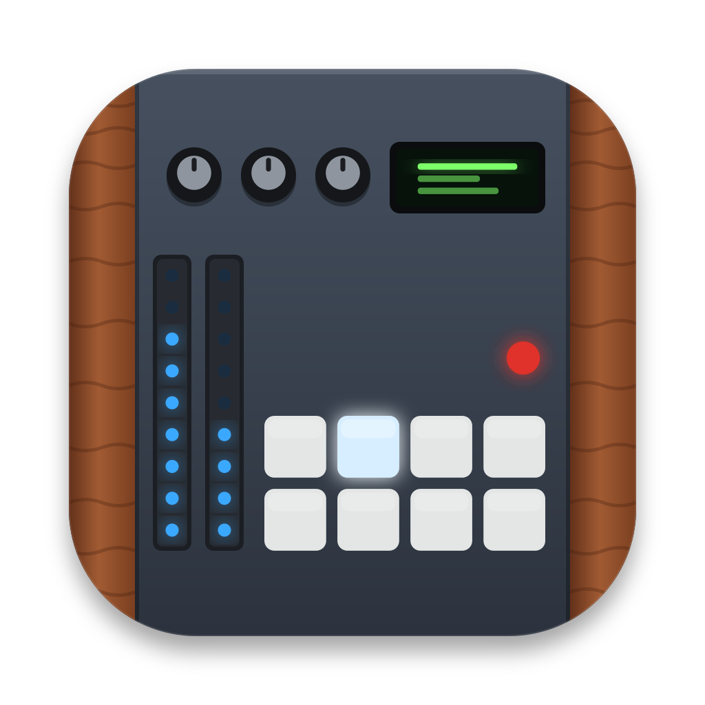
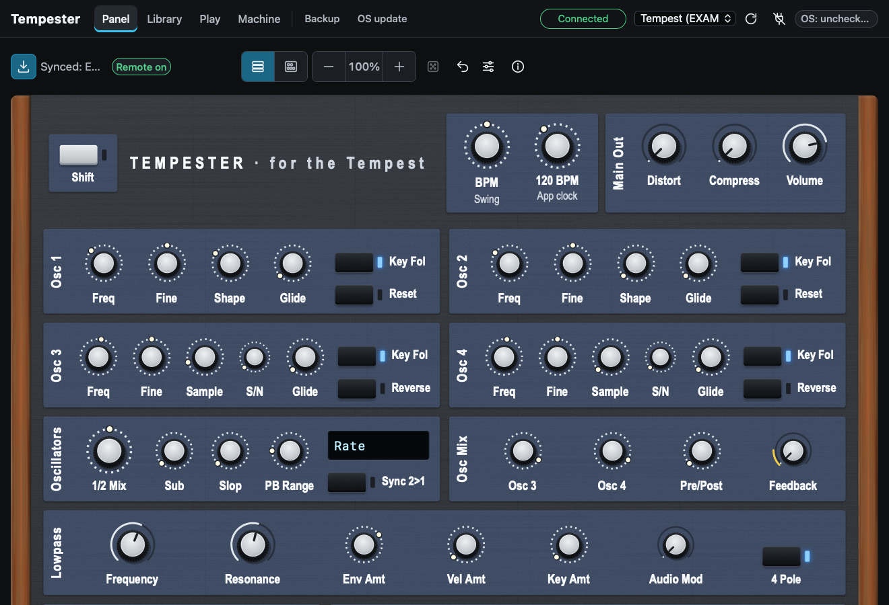
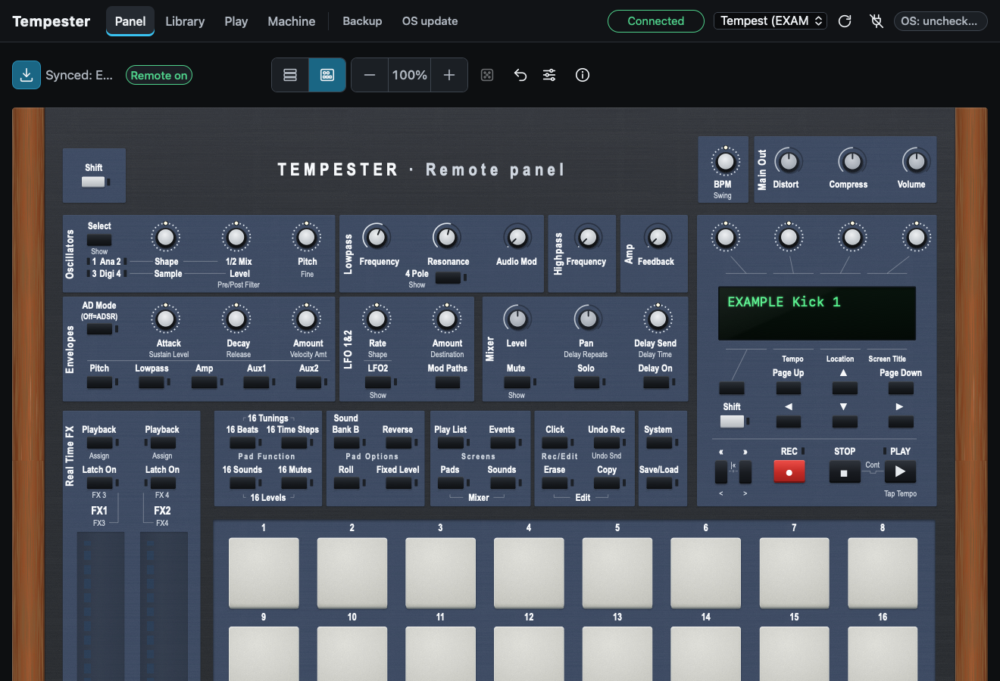
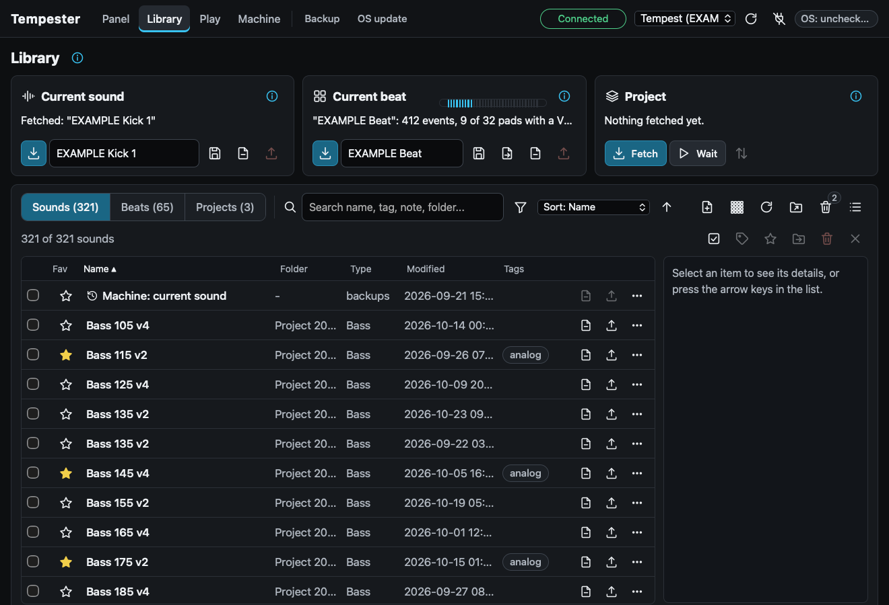
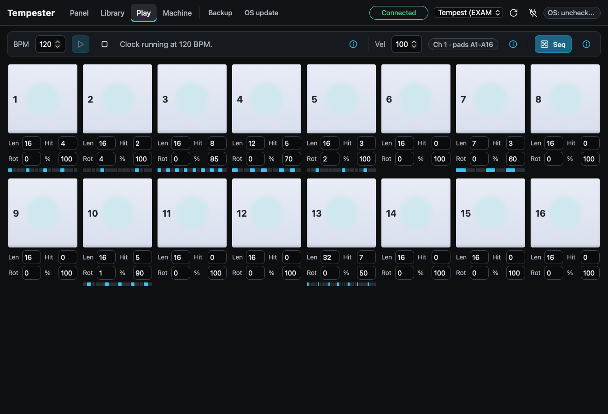
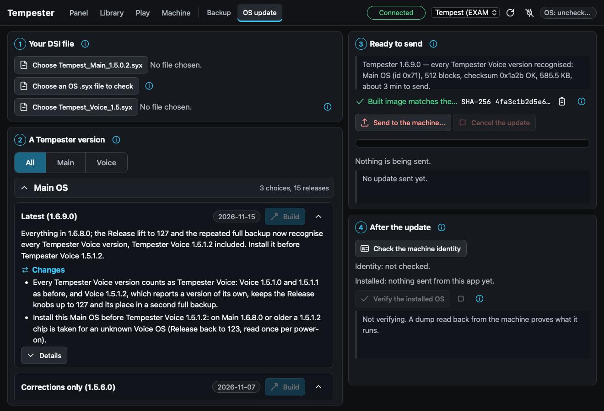
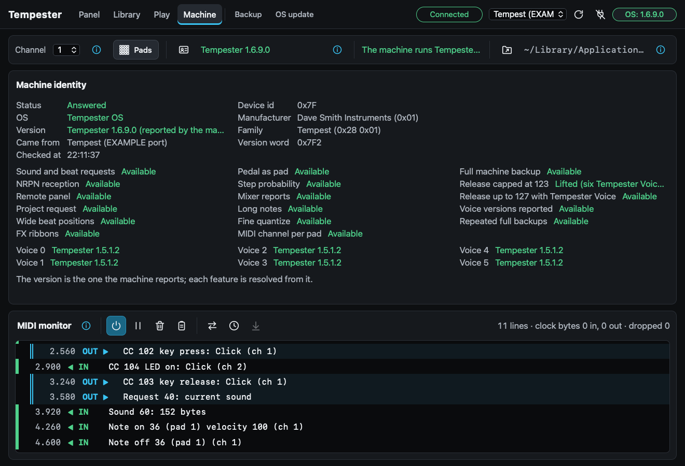
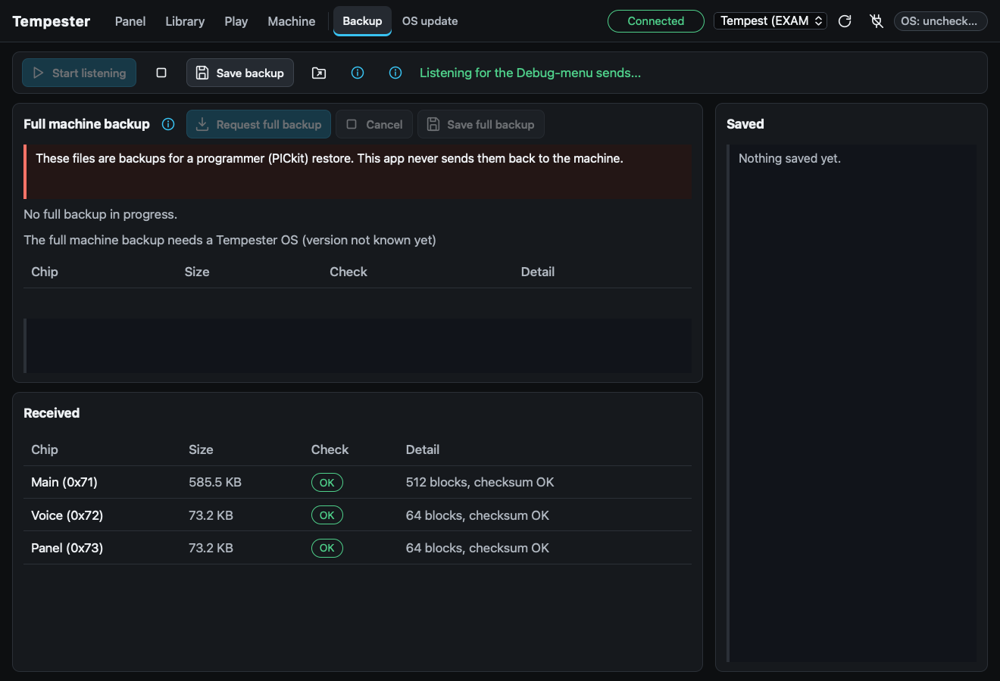

  

<h1 align="center">Tempester</h1>

  <strong>Community firmware, a desktop editor and a DAW plugin for the DSI Tempest drum machine.</strong> 
  Free and open source. Built from your own copy of the official OS, checked at every step.

  
  
  
  
  

  <a href="#get-started">Get started</a> ·
  <a href="https://github.com/onedevinap/tempester/releases">Download</a> ·
  <a href="#tempester-os-releases">Firmware releases</a> ·
  <a href="#documentation">Documentation</a> ·
  <a href="#faq">FAQ</a>

  

## What is Tempester?

Tempester fixes old bugs of the Tempest and opens it up over MIDI. It has three parts.

- **Tempester OS**: community firmware for the Tempest's Main board.
  - It fixes freezes, lost notes, silent voices and memory corruption.
  - It adds sound, beat and project requests, NRPN both ways, the whole front panel over MIDI, a MIDI channel per
    pad, play probability per pad, a full backup over MIDI, and more.
  - The optional **Tempester Voice** does the same for the six sound chips.
- **The Tempester app** (macOS, Windows, Linux): a remote panel, a library for sounds, beats and projects, a step
  sequencer, a MIDI monitor and a safe OS installer.
- **Tempester Control**: a CLAP and VST3 plugin that turns the sound parameters into DAW automation. It is
  experimental.

> [!NOTE]
> Tempester is an independent project. It is **not affiliated with, endorsed by or supported by** Sequential, Dave Smith
> Instruments, Focusrite or Roger Linn Design. See [Legal](#legal).

## Highlights

<table>
  <tr>
    <td width="50%" valign="top">
      
      
<strong>Remote panel.</strong> Every key, knob, pad and LED of the Tempest, live over MIDI.

    </td>
    <td width="50%" valign="top">
      
      
<strong>Library.</strong> Fetch and send sounds, beats and projects. Nothing is overwritten without a copy.

    </td>
  </tr>
  <tr>
    <td width="50%" valign="top">
      
      
<strong>Play.</strong> 16 pads, a MIDI clock and a Euclidean sequencer.

    </td>
    <td width="50%" valign="top">
      
      
<strong>Safe OS updates.</strong> Built from your file, checked by SHA-256, read back from the machine.

    </td>
  </tr>
  <tr>
    <td width="50%" valign="top">
      
      
<strong>Machine.</strong> What the installed OS can do, and a readable MIDI monitor.

    </td>
    <td width="50%" valign="top">
      
      
<strong>Backup.</strong> A full backup of the machine and its operating systems.

    </td>
  </tr>
</table>

Screenshots of the app with example data.

## Get started

You need a Tempest, a USB cable (or a MIDI interface) and a computer.

1. **Install the app** (version 0.1.3). Download it from the
   [Releases](https://github.com/onedevinap/tempester/releases) page.
   - The packages are not signed, so your system blocks the first launch. How to get past it:
     [Installing a release package](docs/building.md#installing-a-release-package).
   - macOS blocks the app or says it « is damaged »? In Terminal:
     `xattr -dr com.apple.quarantine /Applications/Tempester.app`
     ([details](docs/building.md#macos-blocks-the-app-or-says-it-is-damaged)).
   - On Linux, take the two `.deb` files for your Ubuntu release (`_ubuntu24.04` or `_ubuntu26.04`).
   - You can also [build it from source](docs/building.md#building-and-running-the-app).
2. **Prepare the Tempest.** It must run the complete official **OS 1.5.0.2**.
   - Download the package from
     [Sequential's Tempest OS page](https://sequential.com/support/download/tempest-operating-system/).
   - Keep `Tempest_Main_1.5.0.2.syx`: every Tempester OS release is built from it.
   - In System, set the SysEx cable, Remote Pad IN and Remote Pad OUT
     ([which values](docs/user-manual.md#setting-up-the-tempest)).
3. **Back up.** Save your project and make the OS backups (Library and Backup pages).
4. **Install.** On the *OS update* page, choose your official file, pick a release and press **Build**. Then press
   **Send to the machine**. It takes about three minutes. Power the Tempest off and on when told.
5. **Verify.** System > *Main OS Version* shows the new number. **Verify the installed OS** in the app reads it back
   and compares.

Read [Before you install](docs/user-manual.md#before-you-install-a-tempester-version) once before your first install.

To look around without a machine, start the app with `TEMPESTER_FAKE_MIDI=1`. It then talks to a simulated Tempest.

## Tempester OS releases

Tempester OS replaces the Main OS only. Panel and SAM stay those of the official 1.5.0.2 package.

| Release | What it is | Choose it if |
|---|---|---|
| **1.6.9.0** (latest) | Every fix and every addition | you want everything |
| **1.5.6.0** | Bug fixes, requests and NRPN only | you want the fewest changes |
| **DSI 1.5.0.2** | The official OS, rebuilt unchanged | you want to go back |

Each release contains everything of the earlier ones. The app keeps older releases in its History, to read only.

- The full list of changes: [Everything Tempester OS changes](docs/firmware.md#everything-tempester-os-changes).
- Which app feature needs which OS: [the table in the manual](docs/user-manual.md#which-features-need-which-os).
- Each change in detail, with its proof: [firmware notes](docs/firmware.md) and the [changelog](CHANGELOG.md).

### Tempester Voice

Tempester Voice is optional. It updates the six sound chips in one go, built from your own `Tempest_Voice_1.5.syx`.

- **1.5.1.2** is the latest. 1.5.1.0 and 1.5.1.1 are superseded.
- Voices are no longer muted for good, and Release times always end (up to 60 s at 127).
- **Install Main 1.6.9.0 first**, then Voice 1.5.1.2.
- Make a full backup before and after.

Details: [Tempester Voice](docs/firmware.md#tempester-voice).

### Why recipes?

The Tempest's firmware belongs to its maker, so this project distributes none of it.

A Tempester release is a *recipe*: a list of changes written by the project. You apply it to your own official file,
on your computer, with the app or a
[script](docs/building.md#rebuilding-a-firmware-version-from-your-own-dsi-file).

Your file is checked by SHA-256 first. The result is checked against the SHA-256 recorded for the release, so
everyone gets exactly the same image. See the [recipe format](docs/patch-recipe-format.md).

## What is tested

All hardware tests were made on one Tempest, over USB. It now runs Main 1.6.9.0 and Voice 1.5.1.2.

**Tested on the machine**

- Every Tempester OS release from 1.5.1.0 to 1.6.9.0, installed one after the other, without a programmer.
- Every Tempester Voice release, each with a full backup before and after.
- The new functions, including the 1.6.5.0 ones, tried by hand.
- The app on macOS: Main and Voice installs, the full backup page and the identity card.

**Proved before any install**

- Every change is checked word by word against the official image.
- Most changes also run in a simulator of the Main processor, on the real firmware code.
- The same checks must fail on the unpatched image and on deliberately wrong variants.

**Not tested yet**

- Windows and Linux: they pass the automatic tests, but nobody has used them with a Tempest.
- The plugin in a real DAW. It has no window of its own yet.
- The DIN cable.
- Going back to DSI 1.5.0.2 on the test machine. It uses the same update path as every install.
- A few rare paths of the fixes.

Full details: [testing](docs/testing.md).

## Safety

- **Back up first.** Save your project and make a full backup before and after any update.
- **The update routine is never touched.** No Tempester build changes it. A failed update can simply be sent again.
- **Every file is checked** by SHA-256, before and after the install.
- **You can go back at any time.** *Back to DSI 1.5.0.2* on the OS update page rebuilds the official OS from your file.
  Sequential's [update guide](https://sequential.com/updating-tempest-os/) works too.
- **Tempester Voice has one real risk.** A power cut during a Voice update can leave chips that only a programmer can
  bring back. This is also true of an official Voice update.
- **No programmer is needed.** A PICkit backup is optional: see [recovery](docs/recovery.md).
- **No warranty.** You use Tempester at your own risk ([legal notes](docs/legal.md#delivered-as-is)).

## Documentation

| Guide | What you find there |
|---|---|
| [User manual](docs/user-manual.md) | every page of the app, and the plugin |
| [Firmware](docs/firmware.md) | each release and each change |
| [MIDI protocol](docs/midi-protocol.md) | the MIDI messages Tempester OS adds |
| [Testing](docs/testing.md) | what is tested, and what is not |
| [Recovery](docs/recovery.md) | going back, and the optional programmer backup |
| [Building](docs/building.md) | building the app and the releases yourself |
| [Recipe format](docs/patch-recipe-format.md) | how a change is written without DSI bytes |
| [Legal notes](docs/legal.md) | why no DSI material is here |
| [Roadmap](docs/roadmap.md) | what may come next |
| [Changelog](CHANGELOG.md) | the history of the app and the firmware |

## FAQ

<strong>Is this official? Can it affect my warranty?</strong>

No, it is not official. It installs through the Tempest's normal MIDI update, without opening the machine.

Warranty rules depend on the seller and the country. If in doubt, go back to the official OS before a repair.

<strong>Can I go back to the official OS?</strong>

Yes, at any time, over MIDI. See [recovery](docs/recovery.md).

<strong>Which OS must be on the machine first?</strong>

The complete official OS 1.5.0.2: Main 1.5.0.2, Voice 1.5, Panel 1.3 and SAM 1.1. USB updates need Main 1.2 or later.

Step by step: [Before you install](docs/user-manual.md#before-you-install-a-tempester-version).

<strong>Will it change my sounds, beats and projects?</strong>

No. An update rewrites a program, not your data, and the file formats stay the same.

Still, back up your project before any update.

<strong>Does the app work with the official OS?</strong>

Partly. Sending files, backups, the pads and the sequencer work. Fetching, live parameters and the remote panel need
Tempester OS. See [which features need which OS](docs/user-manual.md#which-features-need-which-os).

<strong>Do I need a PICkit or any special hardware?</strong>

No. Everything happens over USB or MIDI. A PICkit backup is an optional safety net ([recovery](docs/recovery.md)).

## How it is made

Tempester is **vibe-coded**. The code, the analyses, the tools and these pages are written by **Claude** (Anthropic's
AI model, through Claude Code), in conversation with the project's author. The author decides what to build, reads
the results, and installs and tests each version on their own Tempest. The author asked for this to be said plainly.

Nothing is taken on the AI's word:

- every firmware change is proved by simulating the machine's own code, with counter-proofs;
- the app and the plugin have their own tests;
- each release is read back from the real machine and compared byte for byte.

The limits are listed in [testing](docs/testing.md#not-verified). Judge the result on the code and the proofs.

## Support and contributions

**Tempester is delivered as is.**

- No support, no warranty, no feature requests, no promised response times.
- Issues and pull requests may be read when time allows, and may stay unanswered.
- You install Tempester OS at your own risk, after reading [Safety](#safety) and [recovery](docs/recovery.md).

If you still send something, read [CONTRIBUTING.md](CONTRIBUTING.md) first. The one strict rule: **never attach or
commit DSI files**, firmware dumps, manuals or pictures.

## Security

A firmware change that could harm a machine, or an app bug that could lose data, is a security issue. Report it
privately as described in [SECURITY.md](SECURITY.md).

## Legal

Tempester is not affiliated with, endorsed by or supported by Sequential LLC, Dave Smith Instruments, Focusrite plc
or Roger Linn Design. « Tempest », « DSI », « Dave Smith Instruments » and « Sequential » are trademarks of their
owners. They are used here only to name the instrument this software works with.

This repository contains no DSI software, manual, picture or logo. The official files come from
[Sequential's website](https://sequential.com/support/download/tempest-operating-system/). Details:
[legal notes](docs/legal.md).

## Licence

Tempester is free software, released under the [GNU General Public License v3.0 or later](LICENSE).
Copyright © Tempester contributors. The Tempest firmware itself is © Sequential LLC and is not part of this project.
