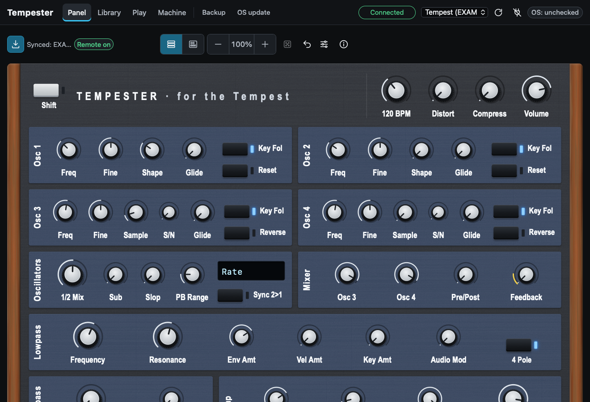
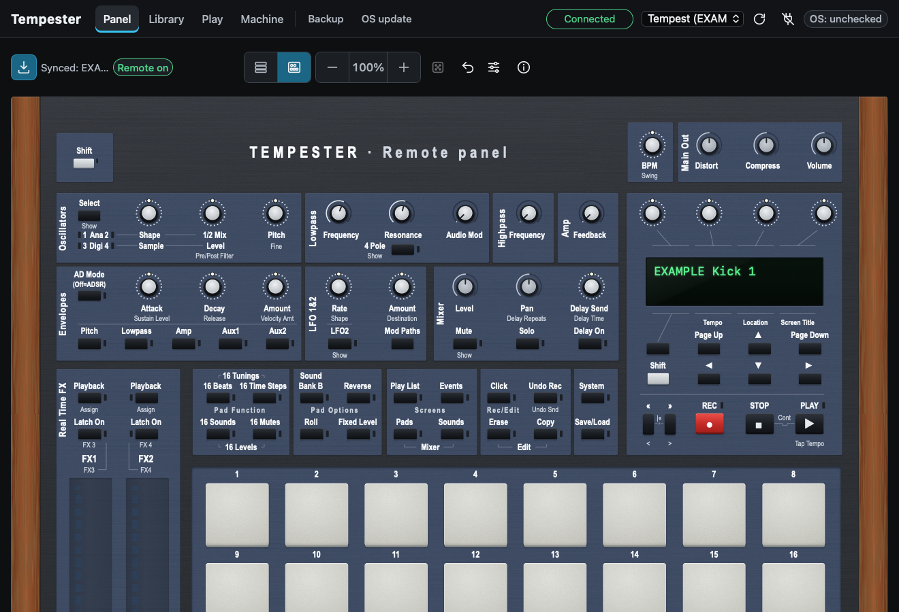
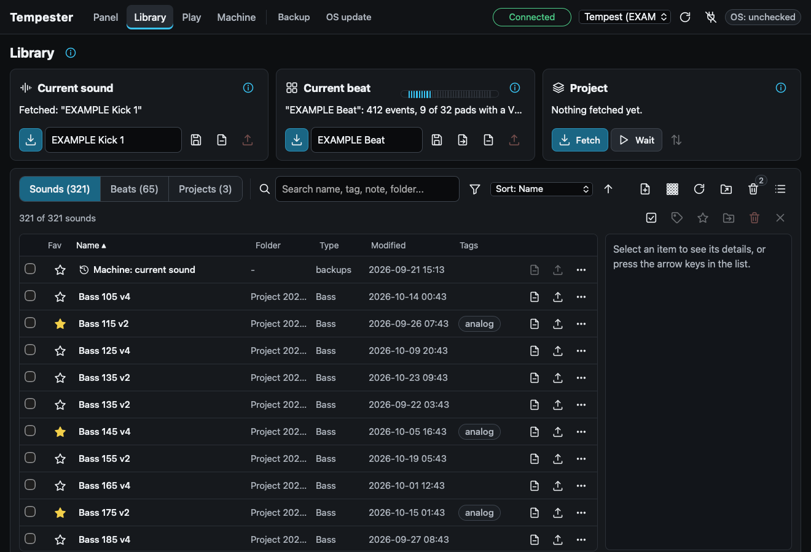
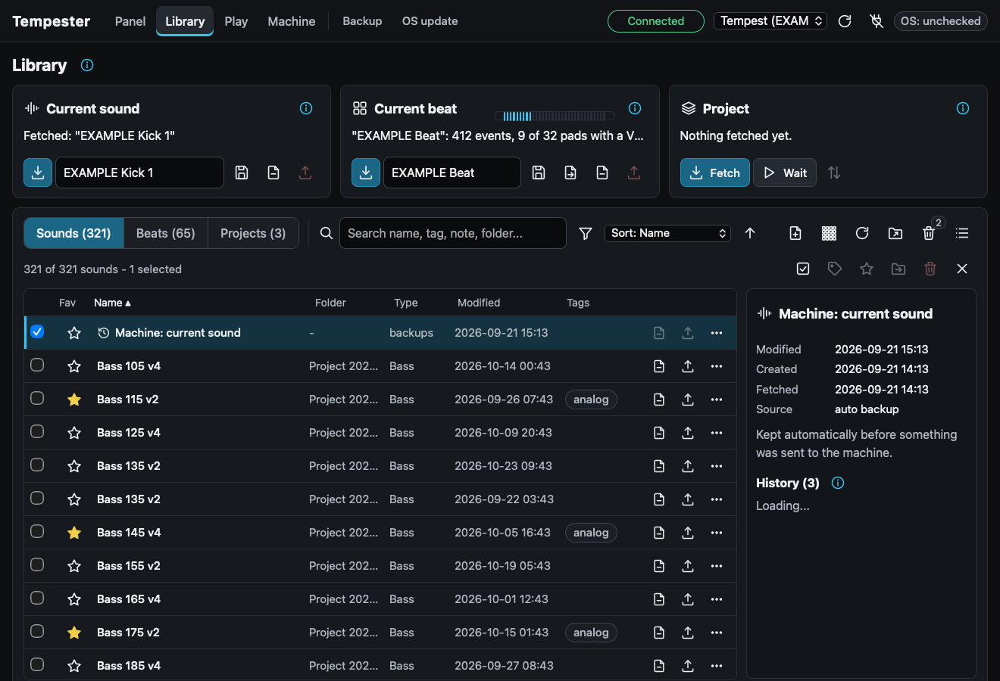
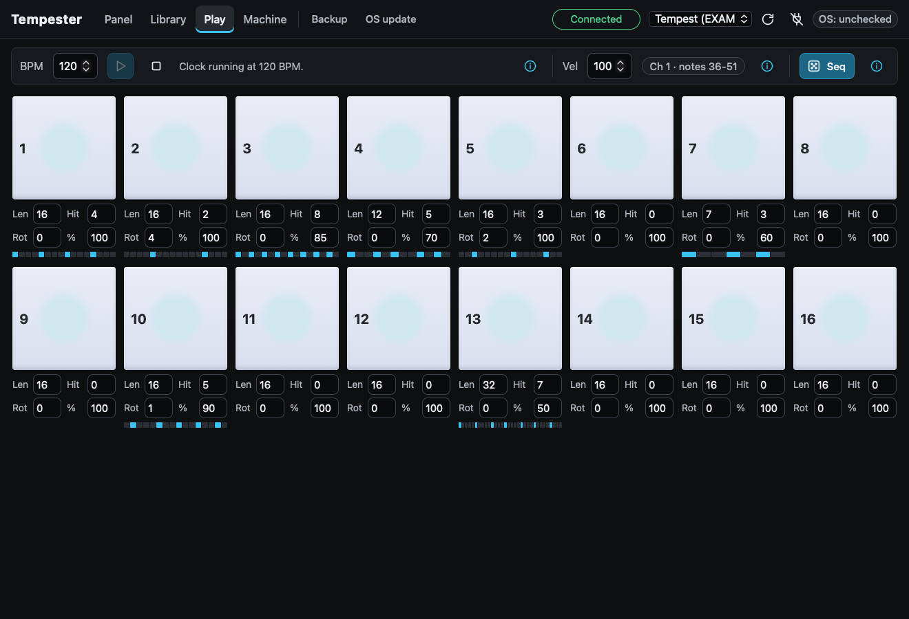
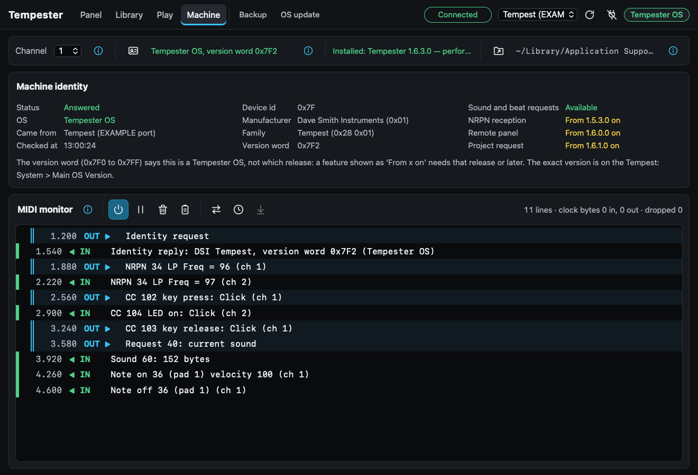
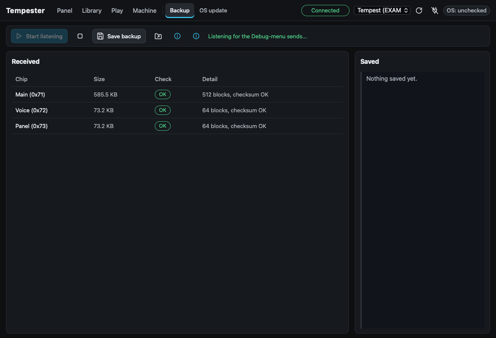
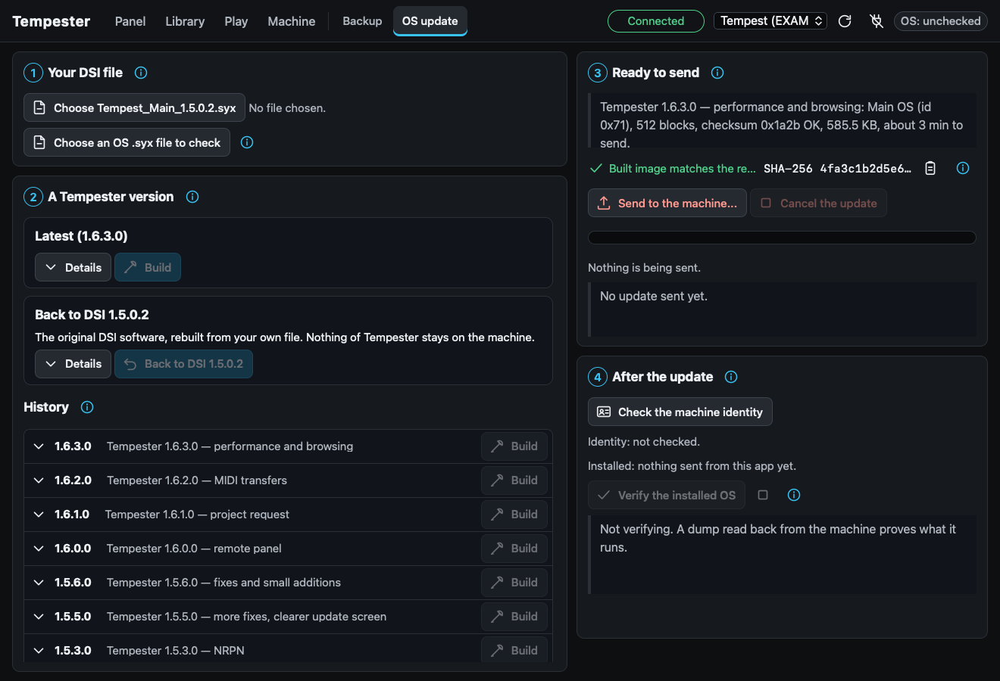
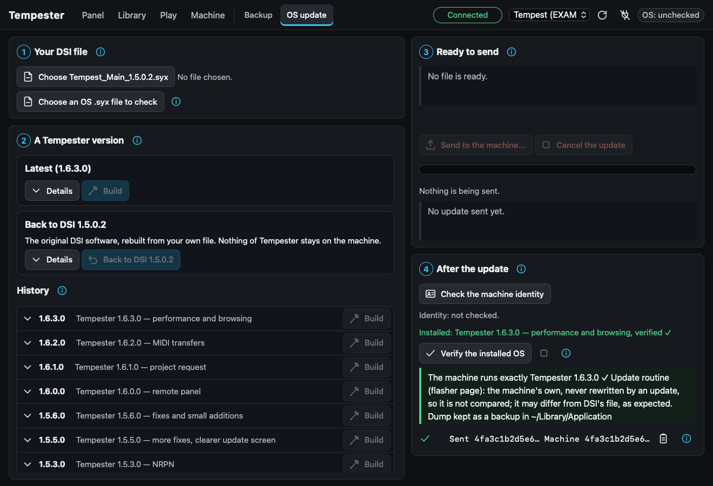

# Tempester user manual

This manual covers the Tempester app 0.1.1, the Tempester Control plugin, and the way to install a Tempester firmware
version. For what each
firmware version changes, see [firmware](firmware.md); for the exact MIDI messages, see [MIDI protocol](midi-protocol.md).

Screenshots show the app's own pages with example data.

- [Setting up the Tempest](#setting-up-the-tempest)
- [Connecting](#connecting)
- [Panel](#panel)
- [Library](#library)
- [Play](#play)
- [Machine](#machine)
- [Backup](#backup)
- [OS update](#os-update)
- [Before you install a Tempester version](#before-you-install-a-tempester-version)
- [Installing a version with the app](#installing-a-version-with-the-app)
- [Going back to the official OS](#going-back-to-the-official-os)
- [Where the app keeps its files](#where-the-app-keeps-its-files)
- [Trying the app without a machine](#trying-the-app-without-a-machine)
- [Tempester Control (DAW plugin)](#tempester-control-daw-plugin)

## Setting up the Tempest

The app talks to the Tempest over MIDI only, by USB or through a MIDI interface on the DIN ports. On the Tempest,
press **System** and set:

| Setting | Value | Why |
|---|---|---|
| *MIDI: SysEx IN+OUT Cable* | **USB** (or *MIDI* for the DIN ports) | sounds, beats, projects, requests and OS updates travel on this cable only |
| *Remote Pad IN Channel* | the app's channel (1 by default, or *All*) | the machine applies the app's notes, parameters (NRPN) and remote panel messages on this channel |
| *Remote Pad OUT* | any channel, **not Off** | the machine reports its parameter changes, LEDs and beat-wide positions on this channel; Off silences them |
| *MIDI Clock* | slave, if you want the app to drive the tempo | for the Play page's clock master |

The app's channel is set on the [Machine](#machine) page. Remote Pad OUT can be any channel: the app finds it by
itself, as the channel the machine's LED messages arrive on, and takes pad notes only from that channel. A sound set as
*Sequencer Sound* (or *Synth Sound*) also plays its pitch on the *Sequencer Out* (or *Synth IN*) channel; those notes
are not taken for pads. If you do not use that output, set *Sequencer Out Channel* to *Off*.

## Connecting



The top bar is on every page:

- the **tabs**: Panel, Library, Play, Machine, then Backup and OS update set apart (used rarely, and delicate);
- the **status pill**: Connected or Disconnected;
- the **port menu** (the Tempest appears as « Tempest » over USB), the **refresh** button that lists the ports again,
  and the **plug** button that connects or disconnects;
- the **OS chip**: after an identity check it says *Tempester OS*, *DSI OS* or *No answer*; a click opens the
  Machine page.

The app never sends anything to the machine without an action of yours, and every action that replaces something on
the machine asks for a confirmation that says what will be replaced.

## Panel

The Panel page edits the sound of the pad selected on the machine. Its toolbar is a row of icon buttons (each has a
tooltip): **Sync** (the download icon) fetches that sound (needs Tempester 1.5.2.0 or later) and looks for the remote
panel (Tempester 1.6.0.0 or later; the chip next to it then says *Remote on*); the **view switch** chooses the Full or
the Machine view; **-** and **+** (or Cmd/Ctrl with -, + and 0) zoom the panel; the **i** button repeats the
explanations below.

### Full view


Everything the Machine view has, plus one knob for each of the 127 sound parameters, grouped as on the machine
(oscillators, oscillator mix, filters, amp, envelopes, LFOs, modulation paths). Turning a sound knob sends an NRPN to the
machine (Tempester 1.5.3.0 or later; the official OS ignores NRPN). Turning a knob on the machine moves the knob here
(the machine sends NRPN on Remote Pad OUT).

- **Knob types follow the machine.** The controls that are absolute knobs on the Tempest (Feedback, Lowpass Frequency,
  Resonance, Audio Mod, Highpass Frequency, Distort, Compress, Volume, Level, Pan) are drawn as knobs with a scale;
  everything the machine sets with an endless encoder is drawn as an encoder (a dashed ring), with a dot at the value.
  The four knobs above the screen are the machine's soft knobs: always encoders.
- **Top bar**, on three panels as on the machine: **Shift**; **BPM** (the machine's tempo encoder, Shift: Swing) next to
  the **App clock** knob (the tempo of the app's own clock, for the Play page); **Main Out**: Distort and Compress
  (CC 12 and 13) and Volume.
- **Mixer**, under the transport: the machine's mixer of the selected pad in the beat: **Level** and **Pan** (knobs),
  **Delay Send** (encoder, Shift: Delay Time), and the **Mute**, **Solo** and **Delay On** keys with their LEDs.
- **Select** and **Mod Paths** keys, with the screen keys.
- Play and Stop send MIDI Start and Stop.

The machine-only controls (Shift, BPM, Volume, the Mixer, Select, Mod Paths, the screen keys) go through the remote
panel (Tempester 1.6.0.0 or later) and are greyed without it. They are the Machine view's own controls: both views show
the same state. With Tempester 1.6.4.0 the machine reports Level, Pan, Delay Send, Delay Time, Delay Repeats, BPM,
Swing, Volume, Distort and Compress, so turning them on the machine moves them here too; with an earlier Tempester
they only follow what the app sends.

In **16 Beats** and **16 Mutes** the machine's own sound knobs act on the whole beat. The Full view still edits the
selected pad only, and a note under the panel says so; use the Machine view to turn the knobs as the machine does.

### Machine view



Only what the physical Tempest has, at the same place: the 10 absolute knobs, the 14 endless encoders (including the
4 soft knobs under the screen), all 49 keys, the 16 pads and the screen area. It needs **Tempester 1.6.0.0** or later
(the remote panel); without it, a notice says so and the controls are greyed.

- A key acts exactly like the machine's key: press and release are both sent, always (also when the pointer leaves the
  key, the window loses focus or the app closes).
- An encoder shows each step as a moving dot and, above it in yellow, the count of a burst (`+3`, `-1`), which fades
  out when you stop turning.
- The machine's LEDs light the keys and pads here.
- In 16 Beats and 16 Mutes the controls the firmware ignores in that mode are greyed, with a tooltip.
- The FX ribbons play over MIDI with Tempester 1.6.3.0 or later: drag to touch, let go to release; a ribbon moved on
  the machine moves here (see [MIDI protocol](midi-protocol.md#fx-ribbons)). Both views have them.
- The Debug menu cannot be opened remotely (by design).

## Library



The Library page has a strip with three cards on top and the library browser under it.

**Current sound** and **Current beat** (Tempester 1.5.2.0 or later to fetch):

1. Press the fetch button: the app asks the machine for the sound of the selected pad, or the current beat.
2. Give it a name and press save: it goes into the library.
3. To send a sound or a beat to the machine, open a `.syx` file (or use the send button of a library row).
   Before sending, the app fetches what the machine holds: identical means nothing to send; already in the library
   means the send goes ahead; different and unknown means it is saved first as « auto backup » in the history of that
   slot. With the official OS (no answer) you get a warning and send only if you confirm.

**Project** (whole project: 16 beats, their sounds and the 4 Play Lists):

- **Fetch** asks the machine for the whole project (Tempester 1.6.1.0 or later).
- **Wait** listens for the machine's own menu *Send Project* (works with any OS).
- The project is saved as received (an exact capture, kept as evidence) and in the standard layout (the one to send
  back), and its beats and sounds are saved as separate files. A project with fewer than 16 beats is saved and named as
  partial, with the missing beats listed.
- **Send a project back** with the send button of a project row. The confirmation says that the machine's whole
  project in RAM is replaced (not saved to its flash until you save it there). The official OS and the Tempester versions
  without patch n°28 misread the Play Lists of a received project (see [firmware n°28](firmware.md#n28-project-receive));
  the app knows which version the machine runs (the exact version it reports, else the one you installed from the app)
  and then offers « Send anyway » or « Send without Play Lists ». With neither known, it warns too.
  Afterwards, **Fetch it back and compare** checks what the machine really holds, difference by difference.

**The browser**:



- Sounds, Beats and Projects tabs with counts; search as you type (name, tag, note, folder, source, sound type);
  filters, sort, favourites and tags.
- A details panel for the selected item: metadata, tags, note, and its **history** (older versions, compare,
  restore).
- Multi-select (click, Shift-click) to tag, favourite, move or trash several items.
- Renaming changes the 20-character name inside the data and the file name together; the old version goes to the
  history.
- Delete goes to the app's trash, which can be restored; only « empty the trash » deletes for good.
- Saving never duplicates or overwrites in silence: the same data is reported as « already in the library », the same
  name with other data as a « modified version », with both dates and a choice.

**Kit builder** (the Kit button of the browser's toolbar; needs a connection and Tempester 1.5.2.0 or later):

1. Pick sounds of the library on one side and put them on the pads on the other (16 or 32 pads): select a sound then
   click a pad, or drag it onto the pad; **Fill** puts the listed sounds on the pads in order.
2. **Write to the machine's beat...** fetches the machine's current beat and says what would be replaced. When the
   library does not hold that beat yet, it is saved first as an automatic backup.
3. After your confirmation, only the sounds of the chosen pads change in the beat; its events and settings are kept.

**Export a beat as a MIDI file**: the export button of the Current beat card, of a beat's details panel or of its row
menu writes a Standard MIDI File into the `exports/` folder (type 1, 96 ticks per quarter note, the machine's own
resolution): the beat's name, tempo and time signature, then one track per pad that plays, on channel 10, on the
pad's note in the pad note table (Machine page), with the velocities and lengths of the beat. An existing file is never overwritten.

## Play



- 16 on-screen pads (A1-A16) send, on the app's channel and with the chosen velocity, the note the machine plays each
  pad with: the **pad note table** of the Machine page (the « Pads » button). The Tempest has its own table
  (System > MIDI Note : Pad), not 36 + pad; the app starts with one machine's table (A1-A15 white keys from C2, A16 61, B 62-77) and learns
  the real table when you tap the pads on the machine in 16 Sounds (Remote Pad OUT on, Tempester 1.6.0.0 or later; only
  notes on the Remote Pad OUT channel are learned, and a note another pad already has is never taken). You
  can also type a note per pad, or reset. The Panel pads, the sequencer and the MIDI export use the same table.
- **Clock master**: set the Tempest's MIDI clock to slave (System), choose a tempo, press **Start**. The app sends MIDI
  Start and 24 clocks per quarter note, and Stop when you press Stop. The clock cannot run during an OS update.
- **Sequencer** (the **Seq** button): under each pad, **Len** is the number of steps (16th notes, 1-32), **Hit** the
  number of hits spread as evenly as possible over them (a Euclidean rhythm), **Rot** a rotation that delays the pattern
  and **%** the probability of each hit. A row of dots shows the pattern. Pads can have different lengths. The
  sequencer plays the pads as notes on the app's clock, so start the clock first; it does not follow an incoming clock.
  Every note is released, also on Stop and on disconnection.

## Machine



- **Channel**: the app's MIDI channel (match the Tempest's *Remote Pad IN Channel*).
- **Check the machine identity**: asks the universal identity request. The *Machine identity* panel shows the answer in
  full: device id, manufacturer, family, version word, the exact Tempester version the machine reports (a Tempester with the
  exact-version request, n°39, answers it to the same button) and every feature, resolved as *Available* or *Not in this version* from that
  version. The official OS answers with its own version word; an older Tempester answers `0x7F2`, which says
  « Tempester » but not which release: its features are then shown as « From x on » (System > *Main OS Version* on the
  machine shows the exact number). Note: the official OS answers the identity request on the DIN port only; Tempester
  answers on the cable set in System.
- **Installed**: the Tempester version last sent from this app and whether a read-back proved it.
- **Data folder**: where everything is saved; the folder button opens it.
- **MIDI monitor**: every message sent and received, with the time since connection and a readable description (notes
  with pad numbers, named CCs and keys, NRPN with parameter names, SysEx by type and size). It is off until you switch
  it on; pause, clear, copy, direction filter and clock display are in its toolbar. While it is off, nothing is copied.

### New on the machine with Tempester 1.6.5.0

These work on the Tempest itself; the app follows them where it edits the data (see the details in the
[firmware notes](firmware.md)).

- **Pad settings page**: with Shift on, a pad press only selects the pad, in every mode (no sound, no MIDI, no
  recording). Press the same pad a second time to open the page: MIDI note, MIDI channel, play probability and Level
  on the four encoders. Any key or another pad leaves the page; leaving saves the note and the channel when the
  transport is stopped.
- **A MIDI channel per pad** (Off, 1-16 with the pad's played note, 1-16 Fix with its fixed note): used by the
  sequencer and by the pads you play. The Machine page's « Pads » panel (notes on top, channels under them) reads, sets and saves it over MIDI (CC 15, 16
  and 17 on Remote Pad IN); if a read times out, check that Remote Pad OUT is not Off.
- **Notes up to 768 steps long** (a whole 8-bar beat); a beat with long notes played on an older OS plays them short.
- **Finer Quantize** (Shift + soft knob 3): 8 Dot, 16 Dot, 32 Dot, 64th, 64T, 8 Quint, 16 Quint and 16 Sept join the
  eight usual values. A project saved with one loads with Quantize Off on the official OS.
- **Copy Sound** (Edit menu) copies the sequence, the Note FX or the mixer settings as the Seq / NoteFX / Mixer
  switches of the Copy screen say, to any beat, also while playing. No undo.
- **Rolls**: with the sequencer stopped, Roll and arpeggio repeats stay on the Quantize grid; the Momentary Roll
  footswitch turns Roll on while pressed and off when released. System > Swing Source « Project+Roll », « Beat+Roll »
  or « System+Roll » makes the beat roll follow the swing (set on the machine; the app edits no System file).
- **Compressor envelope Amount** goes down to −127: Shift + Compression knob opens the envelope page (Attack, Peak
  Hold, Decay, Amount, the 4th encoder); turning the Compression knob itself leaves that page.
- **Small fixes**: the Reverse LED follows the beat after a beat change; Pads + Sounds (« Mixer ») opens the Mixer
  after the compressor pages; in 16 Time Steps a pad lights for every note of its step.

## Backup



The Tempest can send its own operating systems from its hidden **Debug menu**. Capture them before any firmware change:

1. Connect, then press **Start listening**.
2. On the Tempest, hold **both SHIFT keys** and press **SYSTEM** to open the Debug menu.
3. Choose *Send Main OS*, wait until it is done, then *Send Voice OS* and *Send Panel OS* the same way. The cable set in
   *MIDI: SysEx IN+OUT Cable* decides USB or DIN.
4. Each message appears in the list with its check. Press **Save backup**: the files go into a dated folder under
   `backups/`, with a report.

A Voice or Panel send can come back as a **constant** (every byte 0xFF, or every byte 0x10): the machine then sent no
real content. It is flagged, saved under a name that says so, and is not a usable backup. Try again after switching the
machine off and on. This was seen once on a real machine after a long session; after a fresh start the sends carried the
real chips.

Keep these backups private: they are copies of DSI's software (see [legal notes](legal.md)).

## OS update



The page has four numbered panels:

1. **Your DSI file**: choose `Tempest_Main_1.5.0.2.syx` from the official package. The app checks its SHA-256 and
   refuses any other file.
2. **A Tempester version**: the list, newest first, with the description of the selected one. **Build this version**
   applies the version's patches to your file. **Back to DSI 1.5.0.2** prepares your official file unchanged.
   **Or any OS file** checks any `.syx` OS file (Main, Voice, Panel or SAM: id, block count, checksum) and prepares it.
3. **Ready to send**: the file's chip, size, checksum and sending time. For a built version, *Built image matches the
   reference ✓* means the image and the `.syx` have exactly the SHA-256 values recorded for that version (shown in full
   on demand, with a copy button); otherwise the build is refused. An opened file is recognised by its SHA-256 (a
   Tempester version or the official 1.5.0.2), or called *Unknown build*, which needs an extra confirmation.
   **Send to the machine...** asks for a confirmation, then sends at the MIDI cable rate (about 3 minutes for the Main)
   with a progress bar and a **Cancel**.
4. **After the update**: power the Tempest off and on when it says so, reconnect, **Check the machine identity**, then
   **Verify the installed OS** (see below).

## Before you install a Tempester version

Read this section completely before the first installation.

### 1. Start from the complete official OS 1.5.0.2

Tempester replaces **only the Main OS**. It is built for, and was tested with, the Voice, Panel and SAM operating
systems of the same official package as Main 1.5.0.2. Several patches talk to the other chips and rely on what those
versions do:

- the remote panel (n°21, n°22, n°25) uses the Panel chip's key codes and LED commands;
- the compressor envelope fix (n°4b) and the muted-voices fix (n°17) send words to the Voice chips;
- the Debug-menu OS senders (n°15) read the Voice and Panel chips;
- the identity answer carries a version number read from the Voice chip.

So, first:

1. Download the official package from Sequential:
   <https://sequential.com/support/download/tempest-operating-system/> (OS v1.5.0.2, `Tempest_OS_1.5.0.2.zip`). It
   holds four files, one per processor: Main 1.5.0.2, Voice 1.5, Panel 1.3 and SAM 1.1
   (`Tempest_Main_1.5.0.2.syx`, `Tempest_Voice_1.5.syx`, `Tempest_Panel_1.3.syx`, `Tempest_Sam_1.1.syx`).
2. On the Tempest, press **System** and choose **Show System Information**. It lists *Main OS Version*, *Voice OS
   Version*, *Panel OS Version* and *Sam OS Version*. The Main must read **1.5.0.2** (or a Tempester version) and the
   other three must be the versions of that same package. (The exact way the screen prints the Voice, Panel and SAM
   numbers has not been recorded here: compare it with the file names of the package.)
3. If one of them is older, install it from the official files with Sequential's update guide:
   <https://sequential.com/updating-tempest-os/>. You can also send an official file with this app's OS update page
   (*Or any OS file*). Send one file at a time and power the Tempest off and on after each one.
4. **USB updates need Main OS 1.2 or later.** If your Main OS reads less than 1.2, update it through the MIDI DIN ports
   first, as Sequential's guide explains.

### 2. Keep the official Main file

Keep `Tempest_Main_1.5.0.2.syx` from that package. The app builds every Tempester version from it, checks its SHA-256
before building, and checks the result against the values recorded for the version. It is also your way back.

### 3. Back up, and know the way back

- Save what matters on the machine: send the project to the app (Library, *Fetch* or *Wait*), and save sounds and
  beats you care about. Saving them on the machine's own storage as usual is fine too.
- Capture the OS dumps with the [Backup](#backup) page (Main, Voice, Panel).
- **Never power off or unplug during an update.** The Tempest's own screen says « Writing... DO NOT POWER OFF » from
  Tempester 1.5.4.1 on.
- **If an update is interrupted or fails**, send it again. The routine that writes the Main flash lives in the last
  page of the flash, which no Tempester version changes; it stays the one that came with your machine. As long as the
  machine starts and accepts an OS update, a new update (Tempester or the official file) can be sent over MIDI.
- **If the Main no longer starts at all**, MIDI updates are no longer possible: the last resort is a Microchip
  programmer on the Main board. See [recovery](recovery.md). This has never been needed so far; it is optional.

### 4. After installing: verify

The Tempest shows the installed version under System > *Main OS Version*. Then use **Verify the installed OS** on the
OS update page (next section): the app reads the Main OS back from the machine and compares its SHA-256 with the
version you sent.

## Installing a version with the app

1. Do everything in [Before you install](#before-you-install-a-tempester-version).
2. Connect. On the OS update page, choose your `Tempest_Main_1.5.0.2.syx`, select a version, press **Build this
   version**. Check that *Built image matches the reference ✓* appears.
3. Press **Send to the machine...**, read the confirmation, confirm. Do not touch the machine or the cable while it is
   sent. The Tempest shows its own update screen, then writes its flash.
4. When the FX1 LEDs stop at the top, power the Tempest off and on.
5. Reconnect with the top bar, press **Check the machine identity**: a Tempester version answers `0x7F2`.
6. Press **Verify the installed OS**, then on the Tempest open the Debug menu (both SHIFT + SYSTEM) and choose
   *Send Main OS*. The app compares the image it receives with the one it sent:



   - *The machine runs exactly Tempester x ✓*: done; the dump is kept as a dated backup.
   - a mismatch shows both SHA-256 values; a constant or incomplete dump is flagged.

> [!NOTE]
> A real machine's dump always differs from the built image in the last flash page: that page holds the factory update
> routine, which no update rewrites (see [testing](testing.md#verified-on-a-real-machine)). So the app compares the range
> an update writes, and reports that last page apart without comparing it.

The app records what it sent (label, version, date, image SHA-256) and shows it on the Machine page; a send that was
cancelled or failed half way is forgotten.

## Going back to the official OS

On the OS update page, choose your official `Tempest_Main_1.5.0.2.syx` and press **Back to DSI 1.5.0.2**, then send it
like a Tempester version. The Voice, Panel and SAM chips were never changed by Tempester, so nothing else needs to be
sent. Any official file can also be sent with Sequential's own method (SysEx Librarian, MIDI-OX).

## Where the app keeps its files

| System | Folder |
|---|---|
| macOS | `~/Library/Application Support/Tempester` |
| Windows | `%APPDATA%\Tempester` |
| Linux | `$XDG_DATA_HOME/tempester`, or `~/.local/share/tempester` |

`TEMPESTER_DATA_DIR` replaces it. Inside: `sounds/`, `beats/`, `projects/`, `backups/<date>/`, `os/`, `exports/`, the library index
`library.json`, the trash and the history of older versions, and `settings.txt`. Files are never overwritten.

## Trying the app without a machine

```bash
TEMPESTER_FAKE_MIDI=1 cargo run -p tempester    # from app/
```

A scripted Tempest in memory answers identity, sound, beat and project requests, keeps what it is sent, plays the
Debug-menu OS sends and can play a *Send Project*. Nothing reaches a MIDI port, and files go to a separate `fake-midi`
folder. A banner at the top of the window says so.

## Tempester Control (DAW plugin)

Tempester Control is a CLAP and VST3 MIDI effect for your DAW. Its 146 parameters are the Tempest's sound parameters
(the 127 of the Panel page and the Osc 3 / Osc 4 samples), the 8 beat-wide positions, Distort, Compress and Volume.
Automate them, or move them with a controller, and the plugin sends the matching MIDI messages on its output.

- **Install**: the macOS `.pkg`, the Windows setup and the Linux plugins `.deb` can install it (CLAP and VST3, in the
  system plug-in folders); or [build it yourself](building.md#the-plugin).
- **Route it**: put the plugin on a MIDI track and route its MIDI output to the Tempest's port. It opens no MIDI port
  itself. Set its **MIDI Channel** parameter to the Tempest's *Remote Pad IN Channel*.
- **Needs** Tempester 1.5.3.0 or later (the official OS ignores NRPN); Volume needs 1.6.0.0.
- **MIDI learn**: switch MIDI Learn on, touch a parameter in the DAW, then move a controller: that controller now drives
  the parameter (saved with the project). **Clear Mappings** forgets them.
- **Follow Machine** (off by default): the machine's own reports update what the plugin believes the machine holds,
  without sending them back. **Send All** sends every value now; **Send All On Load** does it when the project opens.
- Notes and other messages pass through unchanged. Changes are sent at a safe rate (at most 100 per second).
- There is no editor window yet: the DAW's generic parameter view is used, and a learned controller does not move the
  DAW's own knob.

Not yet tried in a real DAW: whether a given DAW routes a MIDI effect's output is still to be checked (see
[testing](testing.md#not-verified)).
