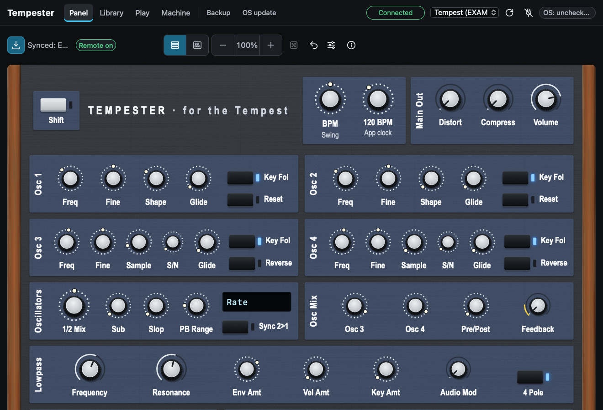
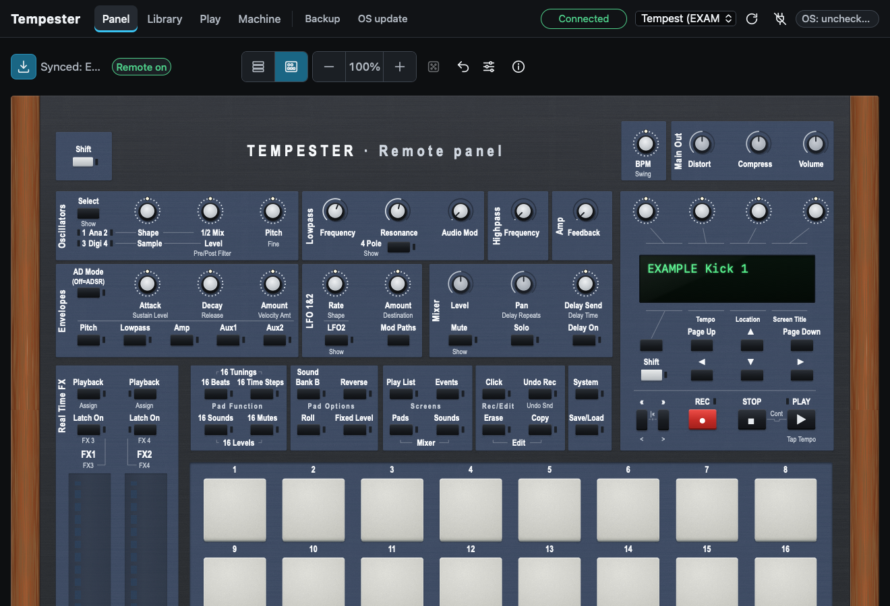
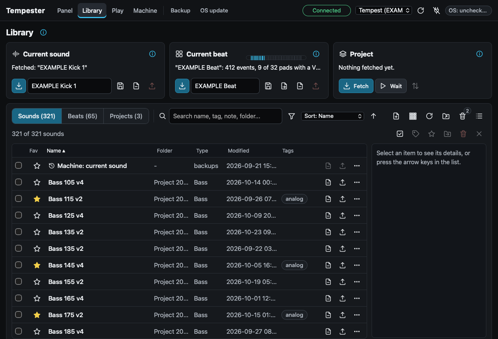
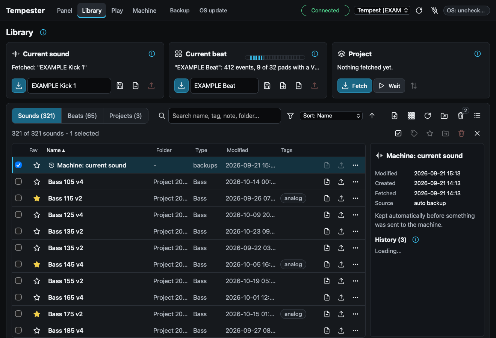
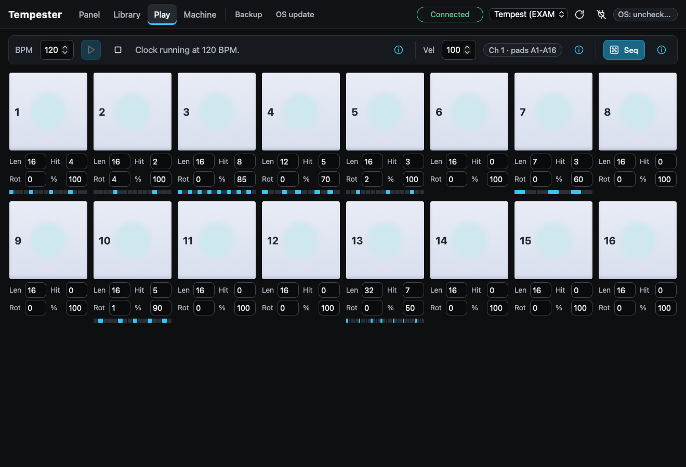
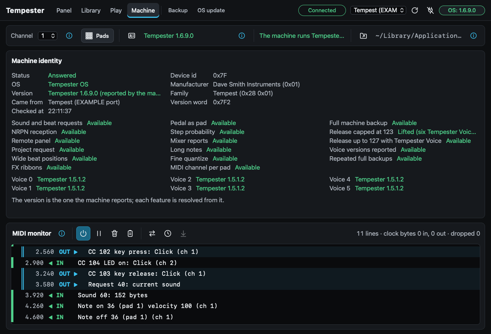
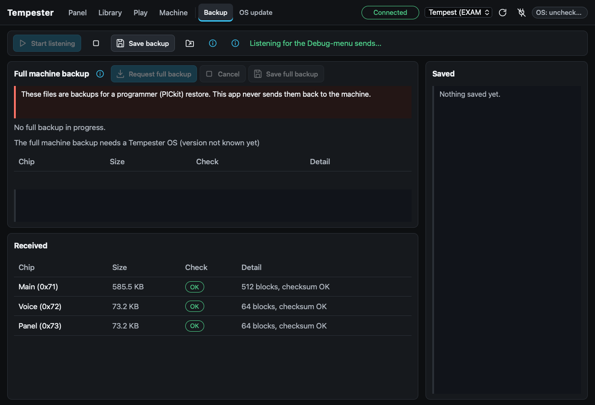
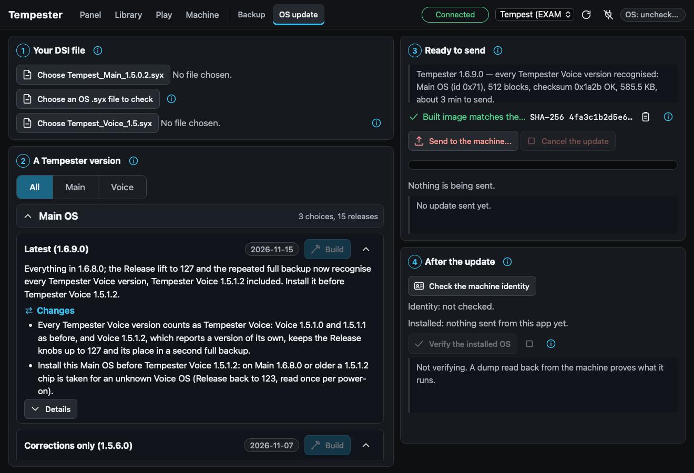
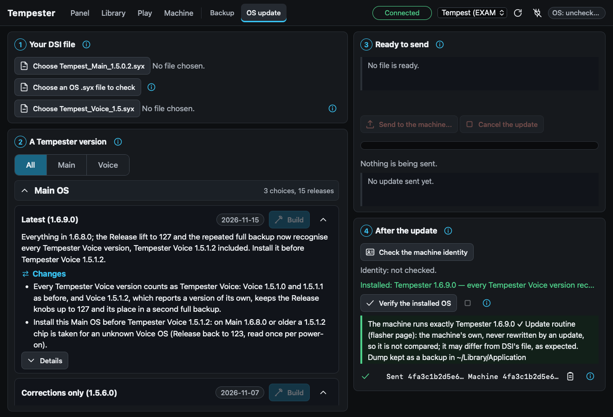

# Tempester user manual

This manual covers the Tempester app 0.1.2, the Tempester Control plugin, and how to install Tempester OS.

What each firmware release changes: [firmware](firmware.md). The exact MIDI messages: [MIDI protocol](midi-protocol.md).
Screenshots show the app with example data.

- [Setting up the Tempest](#setting-up-the-tempest)
- [Connecting](#connecting)
- [Panel](#panel)
- [Library](#library)
- [Play](#play)
- [Machine](#machine)
- [Backup](#backup)
- [OS update](#os-update)
- [Before you install a Tempester version](#before-you-install-a-tempester-version)
- [Installing a version with the app](#installing-a-version-with-the-app)
- [Installing Tempester Voice](#installing-tempester-voice)
- [Going back to the official OS](#going-back-to-the-official-os)
- [Which features need which OS](#which-features-need-which-os)
- [New functions on the machine](#new-functions-on-the-machine)
- [Where the app keeps its files](#where-the-app-keeps-its-files)
- [Trying the app without a machine](#trying-the-app-without-a-machine)
- [Tempester Control (DAW plugin)](#tempester-control-daw-plugin)

## Setting up the Tempest

The app talks to the Tempest over MIDI only: USB, or a MIDI interface on the DIN ports. On the Tempest, press
**System** and set:

| Setting | Value |
|---|---|
| *MIDI: SysEx IN+OUT Cable* | **USB** (or *MIDI* for DIN) |
| *Remote Pad IN Channel* | the app's channel (1 by default), or *All* |
| *Remote Pad OUT* | any channel, **not Off** |
| *MIDI Clock* | slave, if the app drives the tempo |

Why:

- **SysEx cable**: sounds, beats, projects, requests and OS updates travel on this cable only.
- **Remote Pad IN**: the machine applies the app's notes, NRPN and remote panel messages on this channel. The app's
  channel is set on the [Machine](#machine) page.
- **Remote Pad OUT**: the machine reports parameter changes, LEDs and beat-wide positions here. Off silences them.
  The app finds this channel by itself (the one the LED messages arrive on) and takes pad notes only from it.
- **MIDI Clock**: needed for the Play page's clock master.

A sound set as *Sequencer Sound* (or *Synth Sound*) also plays its pitch on the *Sequencer Out* (or *Synth IN*)
channel. The app does not take those notes for pads. If you do not use that output, set *Sequencer Out Channel* to
*Off*.

## Connecting



The top bar is on every page:

- **Tabs**: Panel, Library, Play, Machine. Backup and OS update are set apart: they are used rarely and are delicate.
- **Status pill**: Connected or Disconnected.
- **Port menu**: the Tempest appears as « Tempest » over USB. **Refresh** lists the ports again; the **plug** button
  connects or disconnects.
- **OS chip**: after an identity check it says *Tempester OS*, *DSI OS* or *No answer*. A click opens the Machine page.

The app never sends anything without an action of yours. Every action that replaces something on the machine asks
first, and says what will be replaced.

## Panel

The Panel page edits the sound of the pad selected on the machine. Its toolbar (each button has a tooltip):

- **Sync** (download icon): fetches the sound (Tempester 1.5.2.0 or later). It also looks for the remote panel
  (1.6.0.0 or later); the chip next to it then says *Remote on*.
- **View switch**: Full or Machine view.
- **-** and **+** (or Cmd/Ctrl with -, + and 0): zoom.
- **i**: repeats the explanations below.

### Full view


Everything the Machine view has, plus one knob for each of the 127 sound parameters. They are grouped as on the
machine: oscillators, mix, filters, amp, envelopes, LFOs, modulation paths.

- Turning a knob here sends an NRPN to the machine (Tempester 1.5.3.0 or later; the official OS ignores NRPN).
- Turning a knob on the machine moves it here (the machine sends NRPN on Remote Pad OUT).

What you see:

- **Knob types follow the machine.** The Tempest's absolute knobs (Feedback, Lowpass Frequency, Resonance, Audio Mod,
  Highpass Frequency, Distort, Compress, Volume, Level, Pan) are knobs with a scale. Everything the machine sets with
  an endless encoder is an encoder: a dashed ring with a dot at the value. The four soft knobs above the screen are
  always encoders.
- **Top bar**, on three panels as on the machine: **Shift**; **BPM** (Shift: Swing) next to the **App clock** knob (the
  tempo of the app's own clock); **Main Out** with Distort and Compress (CC 12 and 13) and Volume.
- **Mixer**, under the transport, for the selected pad: **Level** and **Pan** (knobs), **Delay Send** (encoder; Shift:
  Delay Time), and the **Mute**, **Solo** and **Delay On** keys with their LEDs.
- **Select** and **Mod Paths** keys, and the screen keys.
- **Play** and **Stop** send MIDI Start and Stop.

The machine-only controls (Shift, BPM, Volume, the Mixer, Select, Mod Paths, the screen keys) need the remote panel
(Tempester 1.6.0.0 or later). Without it they are greyed. They are shared with the Machine view, so both views show the
same state.

From Tempester 1.6.4.0 the machine reports Level, Pan, Delay Send, Delay Time, Delay Repeats, BPM, Swing, Volume,
Distort and Compress. Turning them on the machine moves them here too. With an earlier Tempester they only follow
what the app sends.

In **16 Beats** and **16 Mutes**, the machine's sound knobs act on the whole beat. The Full view still edits the
selected pad only, and a note under the panel says so. Use the Machine view to turn the knobs as the machine does.

### Machine view



Only what the physical Tempest has, in the same place: 10 absolute knobs, 14 endless encoders (the 4 soft knobs
included), 49 keys, 16 pads and the screen area. It needs **Tempester 1.6.0.0** or later; without it, a notice says
so and the controls are greyed.

- A key acts exactly like the machine's key. Press and release are both sent, always: also when the pointer leaves
  the key, the window loses focus or the app closes.
- An encoder shows each step as a moving dot. A yellow count (`+3`, `-1`) shows each burst and fades out.
- The machine's LEDs light the keys and pads.
- In 16 Beats and 16 Mutes, the controls the firmware ignores are greyed, with a tooltip.
- The FX ribbons work over MIDI with Tempester 1.6.3.0 or later. Drag to touch, let go to release. A ribbon moved on
  the machine moves here ([MIDI protocol](midi-protocol.md#fx-ribbons)). Both views have them.
- The Debug menu cannot be opened remotely, by design.

## Library



The Library page has three cards on top (Current sound, Current beat, Project) and the library browser below.

### Current sound and beat

Fetching needs Tempester 1.5.2.0 or later.

1. Press the fetch button. The app asks for the sound of the selected pad, or the current beat.
2. Give it a name and press save. It goes into the library.

To send a sound or a beat, open a `.syx` file, or use the send button of a library row. The app first fetches what
the machine holds:

- identical: nothing to send;
- already in the library: the send goes ahead;
- different and unknown: it is saved first as « auto backup » in that slot's history, then sent.

With the official OS (no answer) you get a warning, and the send happens only if you confirm.

### Project

A project is the whole set: 16 beats, their sounds and the 4 Play Lists.

- **Fetch** asks the machine for the whole project (Tempester 1.6.1.0 or later).
- **Wait** listens for the machine's own *Send Project* menu (any OS).

The app saves the project twice: as received (an exact capture) and in the standard layout (the one to send back).
Its beats and sounds are also saved as separate files. A project with fewer than 16 beats is saved as partial, with
the missing beats listed.

To **send a project back**, use the send button of a project row.

- The confirmation says that the machine's whole project in RAM is replaced. It is not saved to the machine's flash
  until you save it there.
- The official OS, and Tempester versions without patch n°28, misread the Play Lists of a received project
  ([firmware n°28](firmware.md#n28-project-receive)). The app knows the machine's version (the exact one it reports,
  else the one you installed from the app). It then offers « Send anyway » or « Send without Play Lists ». When it
  knows neither, it warns too.
- Afterwards, **Fetch it back and compare** shows what the machine really holds, difference by difference.

### The browser



- Sounds, Beats and Projects tabs, with counts.
- Search as you type: name, tag, note, folder, source, sound type. Filters, sort, favourites and tags.
- A details panel: metadata, tags, note, and the item's **history** (older versions, compare, restore).
- Multi-select (click, Shift-click) to tag, favourite, move or trash several items.
- Renaming changes the 20-character name inside the data and the file name together. The old version goes to the
  history.
- Delete moves items to the app's trash, which can be restored. Only « empty the trash » deletes for good.
- Saving never duplicates or overwrites silently. The same data is reported as « already in the library ». The same
  name with other data is a « modified version », shown with both dates and a choice.

### Kit builder

The Kit button of the browser's toolbar. Needs a connection and Tempester 1.5.2.0 or later.

1. Put library sounds on the pads (16 or 32). Select a sound then click a pad, or drag it onto the pad. **Fill** puts
   the listed sounds on the pads in order.
2. **Write to the machine's beat...** fetches the current beat and says what would be replaced. If the library does
   not hold that beat yet, it is saved first as an automatic backup.
3. Confirm. Only the sounds of the chosen pads change; the beat's events and settings are kept.

### Export a beat as a MIDI file

Use the export button of the Current beat card, of a beat's details panel, or of its row menu. The app writes a
Standard MIDI File into the `exports/` folder:

- type 1, 96 ticks per quarter note (the machine's own resolution);
- the beat's name, tempo and time signature;
- one track per pad that plays, on channel 10, on the pad's note from the pad note table ([Play](#play));
- the velocities and lengths of the beat.

An existing file is never overwritten.

## Play



### Pads

16 on-screen pads (A1-A16). Each sends, on the app's channel and with the chosen velocity, the note the machine
plays that pad with.

That note comes from the **pad note table** (Machine page, « Pads » button). The Tempest has its own table (System >
MIDI Note : Pad), not 36 + pad.

- The app starts with one machine's table: A1-A15 on the white keys from C2, A16 on 61, B on 62-77.
- It learns your table when you tap the pads on the machine in 16 Sounds. This needs Remote Pad OUT on and Tempester
  1.6.0.0 or later. Only notes on the Remote Pad OUT channel are learned, and a note another pad already has is never
  taken.
- You can also type a note per pad, or reset.

The Panel pads, the sequencer and the MIDI export use the same table.

### Clock master

1. Set the Tempest's MIDI clock to slave (System).
2. Choose a tempo and press **Start**. The app sends MIDI Start and 24 clocks per quarter note.
3. Press **Stop** to send Stop.

The clock cannot run during an OS update.

### Sequencer

Press **Seq**. Under each pad:

- **Len**: the number of steps (16th notes, 1-32);
- **Hit**: the number of hits, spread as evenly as possible (a Euclidean rhythm);
- **Rot**: a rotation that delays the pattern;
- **%**: the probability of each hit.

A row of dots shows the pattern. Pads can have different lengths.

The sequencer plays on the app's clock, so start the clock first. It does not follow an incoming clock. Every note
is released, also on Stop and on disconnection.

## Machine



- **Channel**: the app's MIDI channel. Match the Tempest's *Remote Pad IN Channel*.
- **Installed**: the Tempester version last sent from this app, and whether a read-back proved it.
- **Data folder**: where everything is saved. The folder button opens it.
- **MIDI monitor**: see below.

### Machine identity

**Check the machine identity** sends the universal identity request. The *Machine identity* panel shows:

- the answer in full: device id, manufacturer, family, version word;
- the exact Tempester version, when the machine supports that request (n°39);
- every feature, as *Available* or *Not in this version*;
- from Tempester 1.6.7.0, the Voice OS of each of the six Voice chips, as the Main read it at start-up: *DSI 1.5*,
  *Tempester 1.5.1.0 or 1.5.1.1* (they answer the same word), *Tempester 1.5.1.2*, or *unknown* with the raw word.

About Release:

- With the six chips on Tempester Voice, the *Release capped at 123* row says *Lifted*.
- When the Main does not take the chips as Tempester Voice (Voice 1.5.1.2 on Main 1.6.7.0 or 1.6.8.0), the *Release up
  to 127* row says why it is inactive.

About the version word:

- The official OS answers with its own version word.
- An older Tempester answers `0x7F2`: « Tempester », but not which release. Its features are then shown as « From x
  on ». System > *Main OS Version* on the machine shows the exact number.
- The official OS answers the identity request on the DIN port only. Tempester answers on the cable set in System.

### MIDI monitor

Every message sent and received, with the time since connection and a readable description: notes with pad numbers,
named CCs and keys, NRPN with parameter names, SysEx by type and size.

It is off until you switch it on. Pause, clear, copy, direction filter and clock display are in its toolbar. While
it is off, nothing is recorded.

## Backup



### Full machine backup

Needs Tempester 1.6.6.0 or later.

1. Stop the sequencer. While the machine answers, it shows nothing and reads no MIDI: a few seconds on USB, about
   2 min 35 s on DIN.
2. Press **Request full backup**. The machine sends eight messages:
   - the whole flash of each of the six Voice chips, with their own calibration;
   - the Main boot flash with its configuration words;
   - the System settings, with the MIDI channel of each pad.
3. Each message is checked as it arrives: order, alignment, pages present, calibration page.
4. Press **Save full backup**. This works only when all eight passed. It writes a dated folder: every message as
   received, the System settings file, the pad channels, a manifest and a report. Debug-menu dumps sent right after
   join the same folder.

Good to know:

- **Before Tempester 1.6.8.0, make only one full backup per power-on.** A second one stops the voice chips until the
  machine is switched off. The app refuses it until you press « I powered it off and on ». From 1.6.8.0 there is no
  limit.
- If a Voice message is refused as misaligned or not read, power the machine off and on, then request again.
- These files are for a programmer (PICkit) restore. The app never sends them back to the machine.

### OS dumps from the Debug menu

The Tempest can send its own operating systems from its hidden **Debug menu**. Capture them before any firmware
change:

1. Connect, then press **Start listening**.
2. On the Tempest, hold **both SHIFT keys** and press **SYSTEM** to open the Debug menu.
3. Choose *Send Main OS* and wait until it is done. Then *Send Voice OS* and *Send Panel OS* the same way. The
   *MIDI: SysEx IN+OUT Cable* setting decides USB or DIN.
4. Each message appears in the list with its check. Press **Save backup**. The files go into a dated folder under
   `backups/`, with a report.

A Voice or Panel send can come back as a **constant** (every byte 0xFF, or every byte 0x10). The machine then sent no
real content. The app flags it and saves it under a name that says so; it is not a usable backup. Switch the machine
off and on, and try again. This was seen once on a real machine after a long session; after a fresh start the sends
were correct.

Keep these backups private: they are copies of DSI's software ([legal notes](legal.md)).

## OS update



The page has four numbered panels.

**1. Your DSI files**

- Choose `Tempest_Main_1.5.0.2.syx` from the official package. The app checks its SHA-256 and refuses any other file.
- For Tempester Voice, also choose `Tempest_Voice_1.5.syx` (second picker, same check).

**2. A Tempester version**

- The choices are grouped by OS (Main OS, Voice OS). Each group has its recommended cards and a History (every
  release, newest first, to read only).
- A filter shows every OS or one. Every group, card and history folds.
- **Build** on a card applies the version's patches to your file.
- **Back to DSI 1.5.0.2** prepares your official Main file unchanged.
- The Voice card builds **Tempester Voice 1.5.1.2**: see [Installing Tempester Voice](#installing-tempester-voice).
- **Or any OS file** checks any `.syx` OS file (Main, Voice, Panel or SAM: id, block count, checksum) and prepares it.

**3. Ready to send**

- The panel shows the file's chip, size, checksum and sending time.
- For a built version, *Built image matches the reference ✓* means the image and the `.syx` match the SHA-256 values
  recorded for that version. They can be shown in full, with a copy button. Otherwise the build is refused.
- An opened file is recognised by its SHA-256 (a Tempester version or the official 1.5.0.2). Any other file is an
  *Unknown build*, which needs an extra confirmation.
- **Send to the machine...** asks for a confirmation, then sends at the MIDI cable rate (about 3 minutes for the Main),
  with a progress bar and a **Cancel** button.

**4. After the update**: see [Installing a version](#installing-a-version-with-the-app), steps 4-6.

## Before you install a Tempester version

Read this section completely before your first install.

### 1. Start from the complete official OS 1.5.0.2

Tempester OS replaces **only the Main OS**. It was built for, and tested with, the Voice, Panel and SAM operating
systems of the same official package (and with Tempester Voice). Several patches talk to the other chips
([which ones](firmware.md#prerequisites)), and the identity answer carries a version number read from the Voice chip.

So, first:

1. Download the official package (OS v1.5.0.2, `Tempest_OS_1.5.0.2.zip`) from
   <https://sequential.com/support/download/tempest-operating-system/>. It holds four files, one per processor:
   `Tempest_Main_1.5.0.2.syx`, `Tempest_Voice_1.5.syx`, `Tempest_Panel_1.3.syx` and `Tempest_Sam_1.1.syx`.
2. On the Tempest, press **System** and choose **Show System Information**. It lists *Main OS Version*, *Voice OS
   Version*, *Panel OS Version* and *Sam OS Version*.
   - The Main must read **1.5.0.2** (or a Tempester version).
   - The other three must match that package (or Tempester Voice for the Voice chips).
   - The exact way the screen prints the Voice, Panel and SAM numbers has not been recorded. Compare it with the
     package's file names.
3. If one of them is older, install it from the official files with
   [Sequential's update guide](https://sequential.com/updating-tempest-os/), or with this app's *Or any OS file*. Send
   one file at a time, and power the Tempest off and on after each one.
4. **USB updates need Main OS 1.2 or later.** Below 1.2, update through the MIDI DIN ports first, as Sequential's guide
   explains.

### 2. Keep the official Main file

Keep `Tempest_Main_1.5.0.2.syx`. The app builds every Tempester version from it and checks its SHA-256 before
building. It is also your way back.

### 3. Back up, and know the way back

- Save your project in the app (Library, *Fetch* or *Wait*), and the sounds and beats you care about. Saving them on
  the machine's own storage is fine too.
- Capture the OS dumps on the [Backup](#backup) page. From Tempester 1.6.6.0, make a full backup.
- **Never power off or unplug during an update.** From Tempester 1.5.4.1 the screen says « Writing... DO NOT POWER
  OFF ».
- **If an update is interrupted or fails**, send it again over MIDI. The routine that writes the Main flash is never
  changed by Tempester ([recovery](recovery.md)).
- **If the Main no longer starts at all**, the last resort is a Microchip programmer on the Main board. This has never
  been needed; it is optional.

## Installing a version with the app

1. Do everything in [Before you install](#before-you-install-a-tempester-version).
2. Connect. On the OS update page, choose your `Tempest_Main_1.5.0.2.syx`, select a version and press **Build this
   version**. Check that *Built image matches the reference ✓* appears.
3. Press **Send to the machine...**, read the confirmation, confirm. Do not touch the machine or the cable. The
   Tempest shows its update screen, then writes its flash.
4. When the FX1 LEDs stop at the top, power the Tempest off and on.
5. System > *Main OS Version* shows the new version. Reconnect and press **Check the machine identity**: a Tempester
   version answers `0x7F2`.
6. Press **Verify the installed OS**. On the Tempest, open the Debug menu (both SHIFT + SYSTEM) and choose *Send Main
   OS*. The app compares what it receives with what it sent.



- *The machine runs exactly Tempester x ✓*: done. The dump is kept as a dated backup.
- A mismatch shows both SHA-256 values. A constant or incomplete dump is flagged.

> [!NOTE]
> A real machine's dump always differs from the built image in the last flash page. That page holds the factory
> update routine, which no update rewrites ([testing](testing.md#verified-on-a-real-machine)). So the app compares the
> range an update writes, and reports the last page apart.

The app records what it sent (label, version, date, image SHA-256) and shows it on the Machine page. A send that was
cancelled or failed half way is forgotten.

## Installing Tempester Voice

Tempester Voice is optional. It replaces the program of the six sound chips.

1. **Install Main Tempester 1.6.9.0 first.** On an older Main, a 1.5.1.2 chip keeps the Release knobs at 123, and a
   second full backup in the same power-on skips it. The confirmation warns when the Main announced an older version,
   or none.
2. **Make a full backup** (Tempester 1.6.6.0 or later) right before.
3. Choose `Tempest_Voice_1.5.syx` in panel 1, then **Build** on the **Tempester Voice 1.5.1.2** card. The group says on
   how many chips the machine reports it.
4. Send it. It goes to all six chips at once: there is no trying one chip first.
5. **Make a full backup** right after. It compares, chip by chip, pages 0-40 with the file just sent, and the
   calibration page with your previous backup.

> [!WARNING]
> A power cut while the first 29 of the 41 pages are written can leave chips that only a programmer on their ICSP
> header can bring back. The confirmation says so. See
> [recovery](recovery.md#tempester-voice-going-back-and-its-one-risk).

After the install, the Release knobs (Panel) reach 127 only when the machine reports all six chips on Tempester Voice:

- Tempester 1.6.7.0 and 1.6.8.0: Voice 1.5.1.0 or 1.5.1.1 (they answer the same version word);
- Tempester 1.6.9.0: any Tempester Voice, 1.5.1.2 included.

Tempester Voice 1.5.1.0 and 1.5.1.1 stay in the Voice history, marked *Superseded*. 1.5.1.2 holds the same fixes with
its own version word, so the app no longer builds or sends them.

## Going back to the official OS

1. On the OS update page, choose your official `Tempest_Main_1.5.0.2.syx`.
2. Press **Back to DSI 1.5.0.2**, then send it like a Tempester version.

Panel and SAM were never changed by Tempester.

If you installed Tempester Voice, the Voice chips keep it. To put the official Voice 1.5 back, choose
`Tempest_Voice_1.5.syx` with « Choose an OS .syx file to check » and send it. The app calls it an unknown build and
asks for one more confirmation. See [recovery](recovery.md#tempester-voice-going-back-and-its-one-risk).

Any official file can also be sent with Sequential's own method (SysEx Librarian, MIDI-OX).

## Which features need which OS

| Feature | Official 1.5.0.2 | Tempester OS |
|---|---|---|
| Send sounds, beats, projects, OS files | yes | yes |
| Backup page (Debug-menu dumps) | yes | yes |
| Play page and sequencer | yes | yes |
| MIDI monitor | yes | yes |
| Receive a project sent from the machine's menu | yes | yes |
| Fetch the current sound or beat; kit builder | no | 1.5.2.0 |
| Live sound parameters (Full view); plugin | no | 1.5.3.0 |
| Remote panel (Machine view) | no | 1.6.0.0 |
| Fetch the whole project | no | 1.6.1.0 |
| Send a project back with its Play Lists | no | 1.6.2.0 |
| Full backup | no | 1.6.6.0 |
| Repeated full backups in one power-on | no | 1.6.8.0 |
| Release knobs up to 127 | no | 1.6.7.0, with Tempester Voice |

Each version means « this version or later ». For Release up to 127 with Voice 1.5.1.2, the Main must be 1.6.9.0 or
later.

## New functions on the machine

These work on the Tempest itself. The app follows them where it edits the data. Details:
[firmware notes](firmware.md).

### From Tempester 1.6.5.0

- **Pad settings page.** With Shift on, a pad press only selects the pad, in every mode: no sound, no MIDI, no
  recording. Press the same pad again to open the page: MIDI note, MIDI channel, play probability and Level, on the
  four encoders. Any key or another pad leaves the page. Leaving saves the note and the channel when the transport is
  stopped.
- **A MIDI channel per pad**: Off, 1-16 with the pad's played note, or 1-16 Fix with its fixed note. Used by the
  sequencer and by the pads you play. The Machine page's « Pads » panel (notes on top, channels below) reads, sets and
  saves it over MIDI (CC 15, 16 and 17 on Remote Pad IN). If a read times out, check that Remote Pad OUT is not Off.
- **Notes up to 768 steps long** (a whole 8-bar beat). On an older OS, such notes play short.
- **Finer Quantize** (Shift + soft knob 3): 8 Dot, 16 Dot, 32 Dot, 64th, 64T, 8 Quint, 16 Quint and 16 Sept join the
  eight usual values. A project saved with one loads with Quantize Off on the official OS.
- **Copy Sound** (Edit menu) copies the sequence, the Note FX or the mixer settings, as the Seq / NoteFX / Mixer
  switches of the Copy screen say. Any beat, also while playing. No undo.
- **Rolls.** With the sequencer stopped, Roll and arpeggio repeats stay on the Quantize grid. The Momentary Roll
  footswitch turns Roll on while pressed and off when released.
- **Roll with swing.** System > Swing Source « Project+Roll », « Beat+Roll » or « System+Roll » makes the beat roll
  follow the swing. Set it on the machine: the app edits no System file.
- **Compressor envelope Amount** goes down to −127. Shift + Compression knob opens the envelope page (Attack, Peak
  Hold, Decay, Amount on the 4th encoder). Turning the Compression knob itself leaves that page.
- **Small fixes**: the Reverse LED follows the beat after a beat change; Pads + Sounds (« Mixer ») opens the Mixer
  after the compressor pages; in 16 Time Steps a pad lights for every note of its step.

### From Tempester 1.6.6.0

- **Release values** (1.6.6.0). Pitch, Filter, Aux 1 and Aux 2 Release stop at 123, like Amp Release: the official
  voice chips never end a release at 124-127. A sound saved with 124-127 plays and shows as 123.
- **Release up to 127** (1.6.7.0) with the six chips on Tempester Voice. Their releases always end, up to 60 s at 127.
  Voice 1.5.1.2 needs Main 1.6.9.0. The Panel page follows the machine.
- **Full backup over MIDI** (1.6.6.0; repeatable in one power-on from 1.6.8.0): see [Backup](#backup).
- **The Voice OS of each chip** is reported to the app (1.6.7.0): see [Machine identity](#machine-identity).

## Where the app keeps its files

| System | Folder |
|---|---|
| macOS | `~/Library/Application Support/Tempester` |
| Windows | `%APPDATA%\Tempester` |
| Linux | `$XDG_DATA_HOME/tempester`, or `~/.local/share/tempester` |

`TEMPESTER_DATA_DIR` replaces it.

Inside: `sounds/`, `beats/`, `projects/`, `backups/<date>/`, `os/`, `exports/`, the library index `library.json`, the
trash, the history of older versions, and `settings.txt`. Files are never overwritten.

## Trying the app without a machine

```bash
TEMPESTER_FAKE_MIDI=1 cargo run -p tempester    # from app/
```

A simulated Tempest in memory:

- answers identity, sound, beat and project requests, and keeps what it is sent;
- plays the Debug-menu OS sends, and can play a *Send Project*.

Nothing reaches a MIDI port. Files go to a separate `fake-midi` folder. A banner at the top of the window says so.

## Tempester Control (DAW plugin)

Tempester Control is a CLAP and VST3 MIDI effect for your DAW. It is **experimental**: it has no window of its own
yet, and it has not been tried in a real DAW ([testing](testing.md#not-verified)).

Its 146 parameters:

- the Tempest's sound parameters: the 127 of the Panel page, and the Osc 3 / Osc 4 samples;
- the 8 beat-wide positions;
- Distort, Compress and Volume.

Automate them, or move them with a controller. The plugin sends the matching MIDI messages on its output.

**Install**

- The macOS `.pkg`, the Windows setup and the Linux plugins `.deb` can install it (CLAP and VST3, in the system
  plug-in folders).
- Or [build it yourself](building.md#the-plugin).

**Set up**

1. Put the plugin on a MIDI track.
2. Route its MIDI output to the Tempest's port. It opens no MIDI port itself.
3. Set its **MIDI Channel** parameter to the Tempest's *Remote Pad IN Channel*.

It needs Tempester 1.5.3.0 or later (the official OS ignores NRPN). Volume needs 1.6.0.0.

**Use**

- **MIDI learn**: switch MIDI Learn on, touch a parameter in the DAW, then move a controller. That controller now
  drives the parameter, saved with the project. **Clear Mappings** forgets them.
- **Follow Machine** (off by default): the machine's own reports update what the plugin believes the machine holds,
  without sending them back.
- **Send All** sends every value now. **Send All On Load** does it when the project opens.
- Notes and other messages pass through unchanged. Changes are sent at most 100 per second.
- The DAW's generic parameter view is used. A learned controller does not move the DAW's own knob.
- Whether a given DAW routes a MIDI effect's output is still to be checked.
